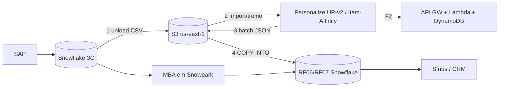
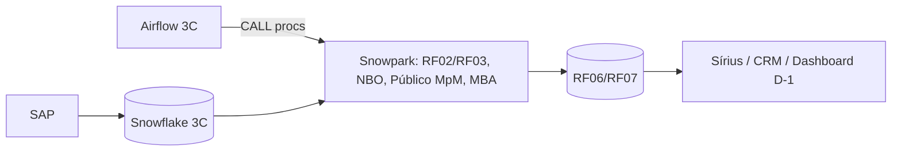
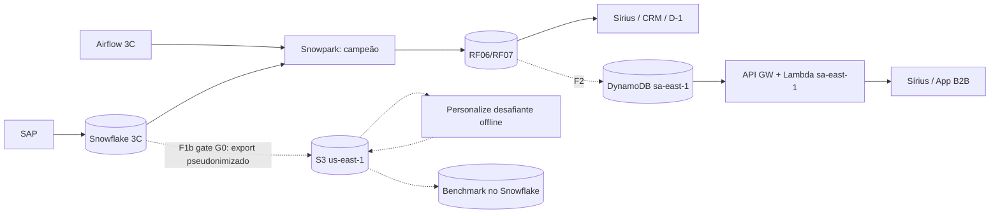
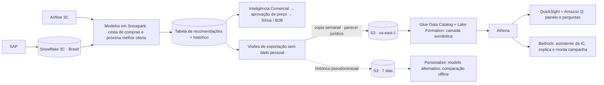
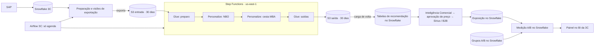

# Arquitetura proposta — 3 Corações · Recomendação de SKU (NBO/MBA) B2B

Versão: v4.4 · 2026-10-29 (v4 de 2026-10-27 atualizada com as decisões de 28 e 29/10) · Status: rascunho para apresentação de pré-vendas e SOW de funding AWS · Autor: ARQ (squad A3), revisado pelo coordenador e pelo ESP
Diagrama: `docs/01-arquitetura/diagramas/3coracoes_to-be_v4.drawio` (abas: 1 Arquitetura · visão geral, 2 Arquitetura · técnica, 3 Dados, acesso e retenção, 4 Fases e decisões, 5 POC para o funding; o comparativo e a aba do Desenho 2 saíram em 29/10). A v3 e a v2 ficam como histórico.
ADRs: `docs/02-adrs/ADR-001-motor-de-recomendacao-e-fases.md` (motor e fases, em parte superado), `docs/02-adrs/ADR-002-camada-de-consumo-aws-bedrock.md` (camada de consumo com Quick e Bedrock, substituído) e `docs/02-adrs/ADR-003-motor-na-aws-personalize-sagemaker.md` (motor na AWS com Personalize; desenho único desde 29/10 e SageMaker AI excluído em 28/10, apesar do nome do arquivo), todos propostos.
Fontes: E§ = `docs/03-fontes/especificacao-3c-v0.txt`; P§ = `docs/03-fontes/proposta-a3data-v1-jun2026.txt`; R§ = `docs/03-fontes/reuniao-interna-2026-10-22.txt`; v1 = diagramas de 22–23/10/2026.

Convenção: FATO (com fonte), INFERÊNCIA, SUPOSIÇÃO e A VERIFICAR são marcados só onde sustentam decisão.

---

## 1. Resumo

- Recomendação (v4, 27/10/2026): **Opção E — motor de recomendação na AWS (us-east-1): Amazon Personalize para a próxima melhor oferta (NBO), o mais por menos e a cesta de compras (MBA: receita SIMS, com o Glue calculando suporte, confiança e lift), sem SageMaker AI (excluído em 28/10), Glue só como apoio, Step Functions orquestrando e o Airflow da 3C só agendando** (seção 4.7, ADR-003). O desenho é único (Desenho 1, confirmado em 29/10): mantém no Snowflake os grupos do teste A/B, o registro de exposição, a medição e as tabelas entregues, com o painel diário no BI atual da 3C. A alternativa com o controle do teste na AWS (Desenho 2, com Athena e Managed Grafana) foi descartada. Quick, Bedrock e Redshift saíram do desenho; a API por CNPJ com NoSQL continua fora do escopo.
- Por quê: o Personalize, com o Glue de apoio, entrega NBO e MBA sem montar uma camada de consumo à parte, o que acelera a prova de valor, aproxima a entrega da proposta V1 e gera consumo AWS para o funding. Contrapartida: o motor deixa o Snowflake, o que contraria E§4.4.1 a 4.4.3 e exige aceite por escrito da 3C (ARQ-Q46); a rodada semanal passa a depender da AWS. A Opção D (v3, motor no Snowflake com camada de consumo AWS) fica como plano alternativo.
- O que muda em relação à proposta V1 (P§Escopo Inicial Sugerido): (a) o Personalize volta a ser o motor do NBO, como na V1, e passa a cobrir também o MBA (receita SIMS e métricas calculadas no Glue; o SageMaker AI foi excluído em 28/10); (b) endpoint, API e NoSQL continuam fora do escopo (consumo por tabela no Snowflake, como a especificação pede); (c) o Airflow só agenda e o Step Functions orquestra. Isso precisa ser apresentado ao cliente com o aceite de E§4.1, 4.3.1.2, 4.4.1 a 4.4.3, RNF04 e da API prometida no M3. O impacto em preço e prazo precisa ser reavaliado (conta AWS, Glue, Step Functions, carga de volta; ESP-v4-05).
- Custo AWS: os dois números circulando são defensáveis, sob premissas diferentes. Com o preço oficial do Personalize v2 (FATO: aws.amazon.com/personalize/pricing, consultado em 2026-10-26), ~US$ 924/mês corresponde a 1 treino semanal com ~30 M interações e 2 lotes semanais de ~300 mil PDVs; ~US$ 5.000/mês corresponde a treinar e inferir separadamente por janela temporal × qualificação de SKU (10 combinações) ou manter campanhas em tempo real ligadas. Na Opção E, o consumo em lote é da ordem de US$ 1 mil por mês (seção 8.6); no cenário de plataforma do funding (×10 em lote e tempo real mínimo, referência E2) chega a ≈ US$ 10,7 mil por mês, ≈ US$ 128 mil por ano (seção 8.8), acima da meta de US$ 100 mil por ano do funding (seção 8.7; ARQ-D12).

## 2. A contradição e como o desenho resolve

| Tema | Especificação do cliente | Proposta A3 V1 | Resolução no desenho v2 |
|---|---|---|---|
| Onde roda o algoritmo | Notebooks Python "com a stack interna da 3corações, totalmente integrado com os dados da camada de dados Snowflake" (FATO: E§4.4.1, especificacao-3c-v0.txt:177-179) | Amazon Personalize M1–M3, challenger open source M4–M5 (FATO: P§Escopo Inicial Sugerido, proposta:284-300) | F1 (MVP): motor em Snowpark/notebooks no Snowflake. Personalize como desafiante offline (F1b) |
| Frequência | Execução semanal após o fechamento da semana, via Airflow (FATO: E§4.4.2, :181-183) + manual a qualquer tempo (E§4.4.3, :185-186) | "Pipeline batch 100% manual" (P§Premissas, :303) e endpoint online no M3 | DAG semanal + disparo manual parametrizado no Airflow da 3C (seção 7) |
| Saída | Tabela única (RF06) e tabela SCD (RF07) (E§5, :228-232) | Storage NoSQL + API REST por CNPJ (P§M3, :288-300); "Contrato da tabela de recomendação no Snowflake" (P§Premissa 4, :330) | RF06/RF07 no Snowflake são a fonte de verdade em todas as fases; DynamoDB/API em F2 é réplica de leitura |
| Armazenamento intermediário | Snowflake | S3 implícito (Personalize importa de S3) | S3 só como destino das cópias semanais sem dado pessoal (fase 2) e do histórico pseudonimizado da comparação, com retenção curta (ADR-002) |
| Região | Não especificada; Snowflake em região a confirmar | Personalize | FATO: Amazon Personalize não está disponível em sa-east-1 (status "isNotExpandingIn") e está disponível em us-east-1 (AWS MCP get_regional_availability, 2026-10-26). Personalize implica dados fora do Brasil → gate G0 |

Leitura arquitetural (INFERÊNCIA): a proposta foi escrita para um cenário de "plataforma AWS de recomendação", e a especificação para um "projeto de ciência de dados dentro da casa". O cliente é quem homologa (P§Responsabilidades, :451) e a especificação é o documento dele; a arquitetura deve obedecer à especificação e acomodar o Personalize onde ele agrega (benchmark com dados reais, aprendizado, base para escala), sem colocá-lo como dependência do MVP.

Atualização v4 (27/10/2026): a direção mudou. A contradição passa a ser resolvida a favor da proposta V1 no motor (Personalize na AWS; o MBA passou ao Personalize e o SageMaker AI foi excluído em 28/10), com o controle do teste e as tabelas entregues no Snowflake (Desenho 1). Isso exige o aceite da 3C (ARQ-Q46). A tabela acima descreve a resolução da v3, mantida como histórico e como plano alternativo (Opção D).

## 3. Premissas de trabalho

| # | Premissa | Classificação | Impacto se falsa |
|---|---|---|---|
| P1 | Snowflake da 3C hospedado em AWS sa-east-1 | SUPOSIÇÃO (ARQ-Q01) | Se em outra nuvem/região, storage integration e custo de saída mudam; LGPD do benchmark muda pouco |
| P2 | Snowpark Python habilitado, com pacotes de terceiros (Anaconda) aceitos e warehouse disponível | SUPOSIÇÃO (ARQ-Q03, Q04) | Sem Snowpark, o motor roda em Python fora do Snowflake (ex.: worker do Airflow ou SageMaker), o que exige nova análise de E§4.4.1 |
| P3 | Airflow 2.x da 3C com provider Snowflake, DAGs entregues por Git/PR | SUPOSIÇÃO (ARQ-Q06, Q07) | Mudança apenas no empacotamento do DAG |
| P4 | Volume: ~300 mil PDVs elegíveis, ~500 SKUs ativos, 10–60 M linhas de faturamento em 12 meses | INFERÊNCIA a partir de "centenas de SKU… centenas de milhares de clientes B2B" (P§Situação Atual, proposta:208-212) | Muda custo do Personalize de forma linear (seção 8) |
| P5 | Sírius e CRM conseguem ler uma view no Snowflake (direto ou via integração existente da 3C) | SUPOSIÇÃO (ARQ-Q19, Q18) | Sem isso, a API (F2) é antecipada |
| P6 | Integração de canais, campanhas, BI e engenharia de dados são da 3C | FATO: P§Escopo do Projeto (proposta:252-253) e P§Premissas 5 e 10 (:332, :340) | — |
| P7 | Feature Store de Clientes existe desde mai/2025; FS de Produtos será construída pela 3C | FATO: E§4.2.1–4.2.2 (:117-141); RNF01 (:254-260) | Histórico de ~17 meses limita a janela de 12 meses a 1 ciclo anual (sazonalidade fraca) |

## 4. Opções

Critérios de decisão (peso entre parênteses): aderência à especificação E§4.4 (alta), risco LGPD/transferência internacional (alta), tempo até a 1ª campanha A/B (alta), qualidade esperada para B2B com centenas de SKUs (média), custo recorrente (média), caminho para escala online (média), coerência com a proposta enviada e com funding AWS (média), dependência de skills escassos (baixa).

### 4.1 Opção A — Personalize como motor (como na proposta V1)

- Desenho: Snowflake exporta interações/usuários/itens pseudonimizados para S3 (us-east-1); Personalize treina UP-v2 (NBO Desconto, filtros para "novos × já comprados") e Item-Affinity (público do Mais por Menos); resultados voltam ao Snowflake. MBA fica no Snowflake de qualquer forma: o Personalize não gera regras de associação com suporte/confiança/lift por abertura (SIMS dá similaridade item-item, que não é o que E§2.1.1 e E§4.5.1 pedem).
- E§4.4.1: **não cumpre**. O algoritmo de NBO roda fora da stack interna; os notebooks viram só "chamadores" de API.
- E§4.4.2: cumpre parcialmente. O Airflow da 3C precisa de credencial AWS (ou disparo indireto) e passa a depender de jobs assíncronos de horas.
- E§4.4.3: cumpre, mas cada reexecução manual paga importação/treino/lote e leva horas (INFERÊNCIA: jobs de import + treino + batch do Personalize não são de minutos).
- RF01 sim (Snowflake → S3); RF02 sim (Snowflake); RF03 parcial (filtros do Personalize + pós-filtro no Snowflake); RF04 sim; RF05 **não pelo Personalize** (fica no Snowflake); RF06/RF07 sim, após carga.
- Riscos: [ALTA] transferência internacional no caminho crítico (gate jurídico bloqueia o MVP); [ALTA] descumprimento da especificação, num cliente com experiência negativa anterior com IA (R§, reuniao:30); [MÉDIA] aberturas mínimas (canal × geo × área × qualificação × janela) mal atendidas por um modelo global com filtros; [MÉDIA] custo cresce com nº de treinos por abertura/janela; [MÉDIA] skills de Personalize alocados em outros projetos (R§, reuniao:36).
- Custo AWS: US$ 650–5.300/mês conforme desenho de treinos (seção 8). Snowflake: baixo (só export e MBA).
- Ganho: maior consumo AWS (base para funding) e caminho natural para tempo real.

### 4.2 Opção B — Somente stack do cliente (especificação ao pé da letra)

- Desenho: notebooks para desenvolvimento; lógica empacotada em módulo Python publicado como stored procedures Snowpark; DAG semanal chama as procedures. Modelos: MBA por regras de associação (FP-Growth) por abertura com backoff; NBO com baseline de popularidade por abertura + modelo de propensão/ranking (ex.: gradient boosting com features da FS Clientes/Produtos e co-ocorrência), separado para itens novos × recompra (E§4.3.1.2); Mais por Menos como ranking de PDVs para um SKU fixo (propensão).
- E§4.4.1, 4.4.2, 4.4.3: **cumpre integralmente**.
- RF01–RF07: todos atendidos dentro do Snowflake.
- Riscos: [ALTA] diverge da proposta enviada (Personalize some) e zera o consumo AWS (sem funding); [MÉDIA] depende de Snowpark e de warehouse com memória para treino (A VERIFICAR: Snowpark-optimized warehouse habilitado); [MÉDIA] custo de créditos Snowflake do time de ciência de dados recai na 3C; [BAIXA] caminho para tempo real exige outra plataforma depois.
- Custo AWS: zero. Snowflake: ~100–400 créditos/mês (seção 8; preço do crédito A VERIFICAR).

### 4.3 Opção C — Híbrido por fases (recomendada)

- F1 (MVP, caminho crítico): igual à Opção B.
- F1b (benchmark, paralelo, opcional por gate): mesmo recorte (filial/famílias-piloto), mesma janela e mesmas métricas offline (precision@k, recall@k, cobertura de catálogo, % de PDVs com recomendação, e margem esperada) do campeão contra o Personalize; resultado em tabela de benchmark no Snowflake. Se o Personalize vencer com margem relevante, entra como braço adicional de A/B (ex.: B1 Snowpark × B2 Personalize) por decisão em ADR próprio.
- F2 (escala): serving online em sa-east-1 lendo RF06 (pré-computado); motor continua onde vencer no champion × challenger.
- E§4.4.1–4.4.3: **cumpre integralmente** no caminho crítico; o benchmark é atividade de avaliação, declarada como tal.
- RF01–RF07: todos no Snowflake; RF04 tem dois motores comparáveis.
- Riscos: [MÉDIA] o benchmark pode não acontecer se G0 for negativo (mitigação: variante C-BR abaixo); [MÉDIA] reordenação do cronograma da proposta precisa ser comunicada; [BAIXA] consumo AWS na POC baixo (funding menor).

### 4.4 Variante C-BR — desafiante em SageMaker AI sa-east-1

> Histórico: em 28/10/2026 o SageMaker AI saiu da arquitetura; esta variante não faz parte do desenho vigente.

- FATO: Amazon SageMaker AI disponível em sa-east-1 (AWS MCP get_regional_availability, 2026-10-26).
- Desafiante open source (ex.: modelos de fatoração/sequenciais/two-tower) treinado em SageMaker Training/Processing em sa-east-1, com batch transform; dados não saem do Brasil. É, na prática, o "challenger open source" de M4–M5 da proposta (P§Escopo, :285) com infraestrutura AWS.
- Quando usar: G0 negativo para us-east-1, ou se o desafiante precisar de GPU/memória que o warehouse não oferece.
- Custo: instâncias por hora de treino/processamento (preços sa-east-1 A VERIFICAR); ordem de dezenas a poucas centenas de dólares por mês em uso semanal. Esforço de engenharia maior que o Personalize (não é gerenciado ponta a ponta).
- Ganho em relação ao Personalize: residência no Brasil, controle do modelo, custo previsível; perda: mais código para manter.

### 4.5 Opção D — Viés AWS: motor na stack 3C; consumo, assistente e comparação de modelos na AWS em região única (v3, substituída pela Opção E na v4)

- Origem: direcionamento do Ricardo em 26/10/2026, revisado no mesmo dia para **uma única região AWS fora do país** (us-east-1), em vez de dividir entre São Paulo e N. Virgínia. Motivo: um só escopo de parecer jurídico, uma só conta e região para operar, e acesso ao Amazon Q in Quick e ao Personalize, que não existem em São Paulo. O custo dessa escolha é que nenhum componente AWS fica no Brasil; por isso só saem cópias sem dado pessoal e histórico pseudonimizado.
- Desenho (aba 2 do diagrama v3): F1 idêntico à Opção C, toda dentro do Snowflake e do Airflow da 3C, cumpre E§4.4.1 a 4.4.3 e RF01 a RF07. A fase 2, na AWS, recebe uma cópia semanal das recomendações e dos agregados por canal, região e mecânica, sem dado pessoal e com CNPJ pseudonimizado; cataloga no Glue Data Catalog com Lake Formation (camada semântica com nomes de negócio); consulta via Athena; publica painéis do A/B no QuickSight com Amazon Q para perguntas em linguagem natural; e oferece um assistente no Bedrock (Knowledge Base estruturada, linguagem natural para SQL) com ferramentas para explicar uma recomendação e montar a lista de campanha para o fluxo de preço. A comparação de modelos usa o Personalize com histórico pseudonimizado apagado em 7 dias, com as mesmas métricas offline do modelo da fase 1.
- Fatos verificados (docs AWS, 26/10/2026): Personalize disponível em us-east-1 e marcado como "não vai expandir" para sa-east-1 e mx-central-1; Amazon Q in Quick disponível em us-east-1 e indisponível em sa-east-1; Bedrock Knowledge Bases com dado estruturado disponíveis em us-east-1 (motores Redshift e Glue Data Catalog; Snowflake não é fonte direta); Bedrock, AgentCore, Athena, Redshift e Glue disponíveis nas duas regiões.
- Parecer jurídico: pedido único ao jurídico e ao DPO da 3C antes do M3, cobrindo (1) transferência das cópias sem dado pessoal e do histórico pseudonimizado para a conta AWS da própria 3C nos EUA, (2) uso de IA generativa sobre esses dados e (3) contrato de operador entre 3C e A3. Nada da F1 sai do Snowflake. Se negativo: F1 segue, painéis no BI atual da 3C, comparação de modelos com SageMaker em sa-east-1 (variante C-BR).
- Amazon Quick (antigo QuickSight) com Amazon Q e Bedrock não concorrem: o QuickSight entrega painéis e perguntas sobre os painéis com pouco esforço (M3 e M4); o Bedrock entrega as ferramentas específicas da Inteligência Comercial (M4 e M5). Se o esforço apertar, o assistente é o primeiro a sair, não os painéis.
- Variante descartada D-full (motor NBO/MBA em Personalize ou SageMaker, Snowflake só como fonte e destino): exige revogar E§4.4.1 por escrito, coloca a transferência internacional no caminho crítico, não resolve o MBA (regras por abertura ficam no Snowflake de qualquer forma) e repete a Opção A com outro nome.
- Riscos: [MÉDIA] parecer negativo tira a fase 2 inteira, não a F1; [MÉDIA] cópia semanal para S3 e segundo catálogo a governar; [MÉDIA] exige competência Bedrock e QuickSight no squad (Eng. ML Sr nos M4 e M5, se a engenharia de dados for coberta por outro perfil); [BAIXA] Redshift Serverless é obrigatório como motor da Knowledge Base estruturada (FATO, docs AWS); custo com pausa automática A VERIFICAR; [BAIXA] latência Brasil–Virgínia irrelevante para uso em lote e painéis.
- Custo AWS (ordem de grandeza, A VERIFICAR na calculadora): S3, Glue e Athena dezenas de dólares; QuickSight por usuário (autores e leitores) e Amazon Q por usuário; Bedrock por token; estimativa inicial US$ 200–600/mês, mais o benchmark do Personalize (US$ 600–900 no projeto inteiro).

### 4.6 Matriz de decisão

| Critério | A · Personalize motor | B · Só stack 3C | C · Híbrido por fases | C-BR | D · Viés AWS (C + consumo AWS) | E · Motor na AWS (v4) |
|---|---|---|---|---|---|---|
| E§4.4.1 notebooks na stack interna | Não cumpre | Cumpre | Cumpre | Cumpre (desafiante fora, declarado) | Cumpre | Não cumpre; exige aceite da 3C |
| E§4.4.2 Airflow semanal | Parcial | Cumpre | Cumpre | Cumpre | Cumpre | Parcial: o Airflow só agenda e carrega |
| E§4.4.3 execução manual | Cumpre, lenta e paga | Cumpre | Cumpre | Cumpre | Cumpre | Cumpre, com modo só inferência a definir; cada rodada paga treino e lote |
| RF05 MBA | Fica no Snowflake | Cumpre | Cumpre | Cumpre | Cumpre | Cumpre, no Personalize (SIMS) com as métricas no Glue; teste de aceite na W1 |
| LGPD no caminho crítico | Transferência internacional | Nenhuma saída | Nenhuma saída (benchmark sob G0) | Nenhuma saída do Brasil | Nenhuma saída na F1; fase 2 só com cópias sem dado pessoal, sob parecer único | CNPJ real fora do país no caminho crítico; mitigação por controle de acesso |
| Tempo até 1ª campanha | Maior (G0 + infra AWS + integração) | Menor | Menor | Menor | Menor (consumo AWS em paralelo) | Médio (conta AWS, integração do Snowflake, aceite e posição jurídica na W0 e na W1) |
| Escala online | Natural | Exige plataforma depois | Planejada em F2 sa-east-1 | Planejada | Lake em S3 pronto; API só com consumidor real | Natural com o Personalize; tempo real só com consumidor |
| Coerência com proposta/funding | Alta | Baixa | Média | Média | Alta (Bedrock, QuickSight, Glue, Personalize na conta) | Alta (Personalize, Glue e Step Functions na conta) |
| Custo AWS POC/mês | US$ 650–5.300 | 0 | ~US$ 50–600 | ~US$ 50–400 (A VERIFICAR) | ~US$ 200–600 + benchmark (A VERIFICAR) | ~US$ 950–1.050 (cenário B, A VERIFICAR) |
| Utilidade para a Inteligência Comercial | Lista por CNPJ via API, sem consumidor | Tabela e BI da 3C | Tabela e BI da 3C | Tabela e BI da 3C | Camada semântica, painéis e agente que explica e monta campanha | Tabela e BI da 3C; sem camada de consumo à parte |

Recomendação (revisada em 27/10/2026): **E**, descrita na seção 4.7. A Opção D (v3) fica como plano alternativo se a 3C não aceitar que o motor saia do Snowflake (E§4.4.1 a 4.4.3). A Opção A só seria defensável com a revogação de E§4.4.1 por escrito; a Opção E é, na prática, a Opção A com o MBA também no Personalize (SIMS, com as métricas no Glue) e o controle do teste no Snowflake.

### 4.7 Opção E — Motor na AWS: Personalize (NBO, mais por menos e MBA), sem SageMaker AI, desenho único (escolhida na v4)

> **Atualização de 28/10/2026 (v4.3, direção do Ricardo):** o MBA passa do SageMaker AI para o Personalize, com base em um relato verbal de um cientista de dados da A3 sobre uma POC anterior para a mesma 3C (suporte, confiança e lift saíram do próprio Personalize, por pedido). A documentação pública do Personalize não confirma esse recurso e o projeto foi apagado; por isso os testes de aceite do NBO e do MBA com pedidos reais rodam o quanto antes (W1 do cronograma, ADR-003, seção "A verificar"). **Ainda em 28/10 o Ricardo excluiu o SageMaker AI da arquitetura**: o desenho oficial usa só o Personalize (e o Glue de apoio); o desafiante de NBO passa a ser outra receita do Personalize; se a cesta não for confirmada, o plano é o piso em SQL (regras de cesta no Snowflake) e nova decisão com a 3C. Este documento foi revisado em 28/10 para refletir essas decisões nos textos vigentes (seções 1, 4.6 a 4.8, 5.1, 5.2, 7, 8.4 a 8.8, 9 e 11); as opções A a D (4.1 a 4.5) são histórico e podem citar o SageMaker AI. Efeito nos custos: sai o SageMaker AI (US$ 100–300 por mês hoje) e entra o uso do Personalize para a cesta (preço A VERIFICAR conforme o recurso usado). Cronograma vigente: W0 a W6 (deck, slide 11). **Cesta (MBA) fechada em 28/10:** Personalize, receita SIMS, com cada pedido como um "usuário", mais um job do Glue que calcula suporte, confiança e lift dos pares por abertura e com backoff (detalhes e limites na ADR-003). Custo modelado em ≈ US$ 29 por mês na base e ≈ US$ 284 em escala (seção 8.8).

> **Atualização de 29/10/2026 (v4.4, direção do Ricardo):** (1) o **Desenho 1 é o desenho oficial e único**; o Desenho 2 (controle do teste na AWS, com Athena e Managed Grafana) foi descartado e o comparativo saiu do diagrama; (2) a **POC para o funding usa o Desenho 1**, com o S3 de entrada e saída retendo os arquivos por 30 dias (valor inicial, ajustável com a 3C); (3) a **escala do funding foi mantida** (projeção de plataforma, seção 8.8): a meta passou a ser **US$ 100 mil de consumo anual projetado, que rendem US$ 10 mil (10%)**, no lugar do mínimo de R$ 50 mil, com a premissa de que muitos outros projetos adotarão o modelo se a POV der certo; (4) o apoio do Desenho 2 (Athena e Grafana, ≈ US$ 175 por mês) saiu dos custos de escala (E2 passou de ≈ US$ 10,8 para ≈ US$ 10,7 mil por mês); (5) o Ricardo vai compartilhar um modelo de SOW para o pedido de funding.

- Origem: direcionamento do Ricardo em 27/10/2026. Motivo: o Personalize é suficiente para NBO e MBA completos (o MBA ficou no SageMaker AI até 28/10 e foi para o Personalize com SIMS e métricas no Glue); estruturar dados para Quick e Bedrock foi considerado um erro agora que a arquitetura está definida de ponta a ponta; objetivo de provar valor rápido e apoiar o funding.
- Divisão das ferramentas: **NBO e mais por menos no Personalize** (duas soluções: recomendação por cliente para o desconto e receita de afinidade com item, em segmentação em lote, para o mais por menos; o job em lote lê do S3 uma lista de clientes e grava as recomendações no S3). **MBA no Personalize** (receita SIMS, em grupo de dados próprio, com cada pedido como um "usuário"; o Glue calcula suporte, confiança e lift dos pares candidatos por abertura, com backoff; notebooks de desenvolvimento para atender RNF04: onde rodam fica em aberto, ARQ-Q08, sem o SageMaker AI). **Glue só como apoio**: monta os arquivos de entrada do Personalize, calcula as métricas da cesta e formata as saídas, com o filtro final. **Step Functions orquestra; o Airflow da 3C só agenda e carrega.**
- FATO (docs AWS, 27/10/2026): o Personalize exige no mínimo 1.000 interações e 25 usuários com 2 ou mais interações, e recomenda 50 mil interações de 1.000 usuários. O filtro por interação usa só o tipo de evento (não a data) e considera as 100 interações mais recentes por cliente e tipo de evento (cota ajustável); valor dinâmico no filtro só aceita IN e =; o job em lote aceita filtros com os valores em `filterValues` no JSON de entrada. A receita de afinidade com item aceita até 500 itens por entrada e exige nova versão do modelo para incluir clientes novos. A VERIFICAR: se as promoções valem em lote, e se o Personalize usa o cadastro de clientes (canal, região, área).
- CONTRADIÇÃO ABERTA (28/10): a documentação pública do Personalize (lista de receitas e SIMS, consultadas em 27/10) não mostra cálculo de regras de cesta (suporte, confiança, lift dentro do mesmo pedido), mas o relato do cientista de dados da A3 diz que o serviço as gerou por pedido. O desenho fechado em 28/10 não depende desse recurso (as métricas saem do Glue); o teste de aceite da W1 decide se a SIMS agrega sobre os pares ordenados por lift; se a cesta falhar, vale o piso em SQL no Snowflake e uma nova decisão com a 3C (o SageMaker AI foi excluído). Margem não é objetivo nativo (só pesos por tipo de evento), então margem e aprovação de preço entram em pós-processamento e na decisão da Inteligência Comercial. O Personalize não explica a recomendação: a coluna de motivo virá das regras de cesta e de atributos. O filtro "já comprado no mês" não é expressável só no Personalize; por isso o filtro final roda no Glue (pedindo mais itens que o top-N) e o estoque é conferido de novo no Snowflake antes de publicar (ESP-v4-01). Janela de tempo de 1 a 12 meses: escolher uma só até o fim da W3 (5 versões comparadas offline) e registrar a decisão (ESP-v4-02).
- Desenho oficial e único (Desenho 1, confirmado em 29/10): grupos A/B, exposição, medição, painel diário e tabelas entregues no Snowflake e no BI atual da 3C (aba 2 do diagrama v4). Entram na AWS só entradas e saídas de cada rodada, retidas 30 dias no S3 (valor inicial, ajustável com o encarregado de dados da 3C).
- Desenho 2 (DESCARTADO em 29/10, só histórico): sorteio dos grupos, medição e painel também na AWS: tabelas Iceberg no catálogo do Glue, Athena e Amazon Managed Grafana. A aba do diagrama e o comparativo foram retirados na v4.4. FATO (docs AWS): o Managed Grafana lê o Athena sem plugin pago e autentica por IAM Identity Center ou SAML; ler o Snowflake direto exige o plugin Enterprise, com taxa por usuário ativo; preço de exemplo na página da AWS: US$ 9 por editor e US$ 5 por leitor ativo por mês (A VERIFICAR).
- Orquestração (padrão proposto, A VERIFICAR com ARQ-Q06 e ARQ-Q49): o Airflow não chama a AWS e não guarda credencial AWS. A exportação do Snowflake grava um arquivo de manifesto no S3; um evento do S3 aciona o Step Functions; ao fim, a AWS grava um arquivo de sucesso. O Airflow espera esse arquivo listando o stage e então carrega as tabelas no Snowflake, junta o grupo do teste, troca a tabela da semana de uma vez, guarda o histórico, roda os testes de contrato e avisa a Inteligência Comercial. O Personalize não tem integração síncrona no Step Functions: o fluxo precisa de um laço de consulta de status. O NBO e a cesta são independentes e podem rodar em paralelo.
- Segurança (ESP-v4-07 e 08): o Ricardo decidiu que a A3 trabalha com os dados reais por enquanto; o risco que o especialista apontou (a regra "a A3 nunca lê linhas com identificador" não fecha com a A3 desenvolvendo na AWS) fica tratado por acesso nominal, registrado no CloudTrail e revisado pela 3C, sob contrato de operador. O Step Functions trafega só caminhos de arquivos. O acesso por endpoint privado vale para o pipeline; o Personalize e a integração do Snowflake exigem exceção por papel na política do bucket.
- Piso e decisão E ou D (ESP-v4-06): na fase 1 a A3 mantém uma recomendação por popularidade e cesta em SQL no Snowflake, como régua offline para provar o ganho do Personalize e como plano de contingência. A decisão entre E e D sai no fim da W1, com base nos testes de aceite, nesse piso e na posição jurídica.
- Dados e acesso (decisões do Ricardo em 27/10): o **código do cliente do SAP substitui o CNPJ nas cópias** (o motor não precisa do CNPJ; a chave ainda liga ao CNPJ, que pode ser dado pessoal no caso de MEI e empresário individual); a equipe da A3 **trabalha com os dados reais por enquanto**, sob contrato de operador; a mitigação é controle de acesso rigoroso (aba 3). Retenção de 30 dias nas entradas e saídas do S3 na AWS; o histórico fica no Snowflake. Tudo em us-east-1; a expectativa é de que a transferência não encontre impedimento jurídico (SUPOSIÇÃO do Ricardo, não verificada, ARQ-Q43).
- Painel diário (RNF02): hoje a carga de vendas no Snowflake é semanal. Enquanto o time da 3C não entregar o novo processo de carga diária (ARQ-Q45), o painel D-1 atualiza semanalmente; quando a carga ficar diária, basta trocar o parâmetro da exportação e do painel.
- Riscos: [ALTA] contraria E§4.1, 4.3.1.2, 4.4.1 a 4.4.3 e RNF04, o aceite por escrito da 3C é condição do contrato (ARQ-Q46); [ALTA] o Personalize pode não cobrir bem os filtros, o "já comprado" e as aberturas (ESP-v4-01 e 02); [MÉDIA] a rodada semanal passa a depender da AWS e da integração de armazenamento do Snowflake; [MÉDIA] código do cliente fora do país, ligável ao CNPJ de MEI e empresário individual (ARQ-Q43); [MÉDIA] competência de ML em AWS no squad; [MÉDIA] a SIMS pode não agregar sobre os pares ordenados por lift e o recurso do relato verbal não foi confirmado (teste de aceite na W1; plano alternativo: piso em SQL); [ALTA] o consumo projetado precisa chegar a US$ 100 mil por ano (≈ US$ 8,3 mil por mês) para o repasse de US$ 10 mil do funding, contra ≈ US$ 1 mil por mês da produção base; a projeção de plataforma o cobre (E2 com +28%), mas só com a receita v2, o ×10 e o lastro dos projetos futuros (seções 8.7 e 8.8).

### 4.8 POC (prova de valor) para o funding

Origem: em 27/10/2026 o Ricardo manteve as decisões de arquitetura e definiu que a preocupação única agora é a arquitetura da POC (POV) para conseguir o funding. Diagrama: aba 5 do diagrama v4.

- Desenho (decisão de 29/10): a POC usa o desenho oficial (Desenho 1) em escala menor, com o S3 de entrada e saída retendo os arquivos por 30 dias (valor inicial). Não há versão alternativa do desenho.
- Objetivo: provar, com dados reais da 3C e em escala menor, que o Personalize (NBO, mais por menos e cesta com SIMS) recomenda melhor que o piso (popularidade e cesta em SQL no Snowflake), e levar à AWS uma arquitetura comprovável com custo projetado.
- Escopo (SUPOSIÇÃO a validar no kickoff): 1 filial, 1 a 2 famílias de produto, 12 meses de histórico por cliente e item, código do cliente do SAP no lugar do CNPJ, disparo à mão (o Airflow entra só na produção), 7 semanas de execução, da W0 à W6 (W0 alinhamentos e acessos; W1 testes de aceite; W1 a W3 construção; W4 a W6 campanhas com teste A/B e resultado).
- Fluxo da aba 5 (10 passos): recorte no Snowflake; exportação com manifesto; S3 de entrada e saída (retenção inicial de 30 dias); Step Functions aciona o Glue (preparo), o Personalize (NBO e cesta, receita SIMS); o Glue calcula as métricas da cesta, junta e filtra as saídas; carga de volta no Snowflake; comparação offline; projeção de consumo na calculadora; decisão.
- Critério de sucesso: métrica offline acordada antes (acerto nos 10 primeiros, cobertura do catálogo, ganho sobre o piso), por mecânica (RF04).
- Testes de aceite o quanto antes (W1): NBO (User-Personalization-v2 treina e gera o lote com pedidos reais da 3C; filtros e cobertura) e cesta (SIMS com cada pedido como usuário, comparada aos pares ordenados por lift; limites e custo na ADR-003). Dependem de uma amostra de pedidos liberada na W0. Se a cesta falhar, vale o piso em SQL e nova decisão com a 3C.
- Custo: cenário A da seção 8.6, cerca de US$ 1,2 a 2,4 mil no piloto inteiro; franquia gratuita do Personalize nos 2 primeiros meses (A VERIFICAR).
- Relação com o funding (regra de 27/10 e meta de 29/10): a AWS paga 10% do consumo anual projetado da produção, na conta da 3C. A POC em si consome pouco; o argumento é a projeção de escala. A meta, definida pelo Ricardo em 29/10, é **US$ 100 mil de consumo anual projetado, que rendem US$ 10 mil de repasse** (≈ US$ 8,3 mil por mês; a nota anterior usava o mínimo de R$ 50 mil, que pedia ≈ US$ 7,6 mil por mês). A projeção do funding é de plataforma (seção 8.8) e foi mantida em 29/10, com a premissa de que muitos outros projetos entrarão no modelo se a POV der certo: referência E2 (×10 em lote e tempo real mínimo) ≈ US$ 10,7 mil por mês, ≈ US$ 128 mil por ano (+28% sobre a meta); variante E2b ≈ US$ 11,8 mil.

## 5. Desenho detalhado da Opção C

> Nota v4: as seções 5.1 a 5.12 descrevem o motor dentro do Snowflake (Opção C, base da v3). Na Opção E o NBO e o MBA passam para a AWS; o fluxo vigente é o das setas numeradas da aba 2 do diagrama v4. Valem sem mudança as seções 5.6 (aberturas e backoff, como regra de negócio), 5.7 (contratos de dados), 5.9 (mensuração A/B) e 5.10 (fronteira com Sírius, B2B e Salesforce). A seção 5.12 (serving online) continua como evolução.

### 5.1 Componentes e fronteiras

| Fronteira | Componente | Responsável | Observação |
|---|---|---|---|
| Origem (3C) | SAP (ECC ou S/4, on-prem ou RISE: A VERIFICAR, ARQ-Q10) | 3C | Ingestão SAP → Snowflake é da 3C (P§Premissa 10) |
| Snowflake da 3C (nuvem/região A VERIFICAR) | Databases existentes: faturamento, FS Clientes (Visão 360°), estoque, cadastro de produto, FS Produtos (RNF01) | 3C | Somente leitura para o projeto |
| Snowflake da 3C | Database/schema do projeto `RECO` (nome A VERIFICAR com padrão 3C): `STG` (snapshots de entrada por run_id), `CORE` (features, modelos), `OUT` (RF06, RF07, views de consumo), `OPS` (logs, perfil RF02, atribuição A/B, mapa de pseudonimização), `EXPORT` (views do benchmark) | A3 desenvolve, 3C opera após M5 | Ambientes dev/hml/prod: databases separados ou contas separadas (ARQ-D01) |
| Snowflake da 3C | Stored procedures Snowpark Python (pacote `reco_3c` versionado), notebooks (Snowflake Notebooks ou Jupyter: ARQ-Q08), stage interno de artefatos de modelo, Model Registry (se habilitado: A VERIFICAR) | A3 | Notebooks importam o mesmo pacote: atende E§4.4.1 sem duplicar lógica |
| Snowflake da 3C | Warehouse dedicado `WH_RECO_*` com resource monitor | 3C | Custo de créditos: ARQ-Q28 |
| Orquestração (3C) | Airflow (onde roda: A VERIFICAR, ARQ-Q06): DAG `reco_semanal`, DAG `reco_benchmark` | A3 entrega por PR; 3C faz deploy | Conexão Snowflake por usuário de serviço com key-pair |
| Conta AWS da 3C (a criar ou existente: ARQ-Q14), us-east-1 | S3 de troca (SSE-KMS), Amazon Personalize, Step Functions, EventBridge, KMS (CMK), IAM roles, CloudWatch, CloudTrail, AWS Budgets | A3 configura sob aprovação da 3C | Só F1b, sob G0 |
| Conta AWS da 3C, us-east-1 (Opção E, ADR-003) | S3, Glue (apoio), Amazon Personalize (NBO, mais por menos e cesta), Step Functions, KMS, IAM Identity Center, CloudTrail, Budgets | A3 constrói, 3C opera após handover | Sem VPC obrigatória para os serviços gerenciados; Glue em rede privada com endpoints de VPC para S3 |
| Consumo (3C) | Inteligência Comercial, Sírius, CRM/Salesforce (nuvem A VERIFICAR), App B2B (F2), Dashboard D-1 (RNF02) | 3C | Integrações e campanhas são da 3C |

Rede (Opção E): os papéis do pipeline acessam o S3 por endpoint de VPC; o Personalize e a integração de armazenamento do Snowflake não passam pela rede privada da 3C e exigem exceção por papel na política do bucket (ESP-v4-08). A integração do Snowflake usa um papel IAM assumido pelo Snowflake com external ID. PrivateLink para o Snowflake só importa para acesso de clientes (Business Critical, ARQ-Q02) e não é requisito do desenho.

### 5.2 Fluxo semanal (setas numeradas do diagrama, aba Técnica)

1. SAP → Snowflake: ingestão da 3C (diária ou mais frequente; A VERIFICAR, ARQ-Q11).
2. Airflow dispara `reco_semanal` após o fechamento da semana (hipótese: segunda 06h America/Sao_Paulo; ARQ-Q23).
3. Sensor de prontidão: consulta a tabela de controle de carga da 3C (ou `max(data)` do faturamento) para confirmar que a semana fechada está completa.
4. RF01: snapshot das entradas em `STG` com `run_id` (CTAS ou zero-copy clone), garantindo reprodutibilidade.
5. RF02: perfil das variáveis de entrada e comparação com as últimas N execuções; gate (seção 5.5).
6. RF03: pré-processamento e filtros (estoque, comprado no mês, elegibilidade).
7. RF04/RF05: NBO Desconto (novos × recompra), Público Mais por Menos, MBA Combo, em paralelo (procedures independentes).
8. Pós-processamento: backoff por abertura, regras de mecânica, top-N, junção com atribuição A/B vigente.
9. Testes de contrato (seção 7.2).
10. Publicação: troca atômica da RF06 (`ALTER TABLE ... SWAP WITH`) e `MERGE` na RF07, na mesma transação lógica; log em `OPS.EXECUCAO_LOG`.
11. Notificação à Inteligência Comercial (e-mail/Teams) com resumo da execução.
12. Consumo: Sírius/CRM/IC leem views em `OUT` (ex.: `VW_RECO_SIRIUS`, `VW_RECO_CRM`, `VW_COMBOS_REGIONAL`).
13. Retorno: exposição e resposta de campanha (Sírius/Salesforce) e faturamento D-1 chegam ao Snowflake por integração da 3C → `VW_RESULTADO_AB` → Dashboard D-1.
14. (F1b) `reco_benchmark`: views `EXPORT` → `COPY INTO @stage` (CSV, S3 us-east-1) → manifesto dispara EventBridge → Step Functions (import, treino, batch inference) → saída JSON em S3 → `COPY INTO` no Snowflake → `OPS.BENCHMARK_RESULTADO`. O Airflow da 3C não recebe credencial AWS: o acoplamento é só pelo stage.
15. (Opção E, ADR-003) a rodada semanal exporta as visões para o S3 em us-east-1; o Step Functions executa Glue (preparo), Personalize (NBO e cesta) e Glue (métricas da cesta e saídas); os resultados voltam ao Snowflake como tabelas de recomendação. API por cliente só como evolução, com consumidor online. Fluxo numerado: aba 2 do diagrama v4.

### 5.3 Execução manual (E§4.4.3)

- Mesmo DAG, disparado pela UI/API do Airflow com parâmetros: `semana_ref` (padrão: última semana fechada), `mecanicas` (lista), `modo` (`normal` | `dry_run` | `reprocesso`), `ignorar_gate_rf02` (exige `justificativa`, registrada no log).
- `max_active_runs=1` e `catchup=False` no DAG; lock lógico em `OPS.EXECUCAO_LOG` evita duas publicações simultâneas.
- `dry_run` grava em schema de sandbox e não publica: serve para a IC simular uma campanha no meio da semana.
- Quem pode disparar: papel a definir (ARQ-Q40); hipótese: Eng. Dados 3C e A3 durante a POC, IC via solicitação.

### 5.4 Entrega de código e notebooks

- Repositório Git da 3C (ARQ-Q07) com: pacote Python `reco_3c` (funções RF01–RF07), notebooks (exploração, treino, avaliação, "executar pipeline" chamando as mesmas funções), DAGs, DDL versionado, testes.
- Produção: procedures Snowpark registradas a partir do pacote (deploy por CI da 3C ou script de deploy entregue pela A3). Alternativa, se o padrão da 3C for executar notebooks: `EXECUTE NOTEBOOK` (Snowflake Notebooks) ou papermill no worker do Airflow (A VERIFICAR qual padrão a 3C usa, ARQ-Q09). Recomendação: procedures, porque são testáveis, versionáveis e não dependem do estado do notebook.
- Registro de modelos: Snowflake Model Registry se habilitado; senão, stage interno + tabela `OPS.MODELO_VERSAO` (model_name, model_version, hash do código, parâmetros, métricas offline, data de treino, janela de dados).

### 5.5 Pré-processamento (RF02 e RF03)

RF02 — relatório pré-execução (E§5, :216-218):
- `OPS.PERFIL_ENTRADA` (run_id, tabela, coluna, métrica, valor): contagem, nulos, cardinalidade, novos domínios (valores categóricos não vistos nas últimas N execuções: SKU, filial, área de atuação, canal), distribuição de recência/frequência, % de PDVs sem histórico na janela.
- Gate com dois níveis: alerta (segue e notifica) e bloqueio (não publica, mantém a última RF06 válida). Limiares iniciais propostos, a calibrar em M1: novo domínio em abertura → alerta; queda de mais de 20% no nº de PDVs elegíveis ou de linhas de faturamento da semana → bloqueio (SUPOSIÇÃO; validar com DAD/IC).
- Exportação do relatório: view `OUT.VW_RELATORIO_PRE_EXECUCAO` (o "exportação" de RF02 vira consulta no Snowflake; arquivo, se exigido, por unload sob demanda).

RF03 — regras (E§5, :220-222):
- Estoque: remove SKU sem estoque na filial/CD que atende o PDV (fonte, nível e frescor A VERIFICAR, ARQ-Q12). Regra aplicada no pós-processamento também, porque o estoque muda entre o treino e a vigência; `estoque_ok` fica gravado por linha.
- Compra recente: remove SKU comprado pelo PDV no mês (mês calendário × últimos 30 dias: ARQ-Q13). Não se aplica à qualificação "recompra" da mecânica Desconto? Ambiguidade: E§4.3.1.2 fala em recompra de "qualquer item" para clientes sem compra há 60 dias; para esses PDVs a regra de compra no mês é vazia por definição (INFERÊNCIA). Confirmar.
- Elegibilidade do público: canais e áreas selecionadas com faturamento nos últimos 6 meses (E§4.2.1, :128-130), status/bloqueio.
- Auditoria: `OPS.EXCLUSOES_RESUMO` (run_id, regra, mecânica, abertura, qtd_pdv, qtd_par_pdv_sku): só agregados.

### 5.6 Modelos, aberturas e backoff

- Aberturas (E§4.1, :91-113): canal, regional/filial/UF/capital × interior, área de atuação, qualificação de SKU, janela 1/3/6/9/12 meses.
- Decisão de desenho proposta: janela temporal e geografia entram como **features e filtros de candidatos**, não como multiplicador de modelos. Treina-se por qualificação (novos × recompra, exigido por E§4.3.1.2) e por mecânica; a janela "vencedora" por abertura é escolhida na validação e gravada em `janela_meses`. Isso evita 2 × 5 × N modelos, que é o principal multiplicador de custo e de manutenção (seção 8).
- Backoff hierárquico: filial → regional → canal → nacional, quando o suporte da abertura fica abaixo do mínimo (ex.: nº de PDVs ou transações; limiar a calibrar). Gravado em `nivel_backoff` para a IC saber o que é recomendação local e o que é genérica (atende E§4.3.1.1: não levar recomendação do Sul para o Norte sem marcar).
- MBA (Combo): regras de associação por abertura (regional/filial, E§4.5.1), com suporte, confiança e lift; âncora = SKU frequente, complementar = SKU-alvo de penetração.
- NBO (Desconto): baseline popularidade por abertura (obrigatório como piso) + modelo de ranking por PDV × SKU candidato.
- Mais por Menos: E§2.1.2 pede ranking de itens; E§4.5.3 diz que o SKU é definido por regra/escoamento e o algoritmo escolhe o público. O desenho suporta os dois grãos (`grao` em RF06); a definição é bloqueante para o contrato (ARQ-Q30).

### 5.7 Contratos de dados

RF06 — `OUT.RECOMENDACAO_ATUAL` (tabela única: última execução válida). Nomes A VERIFICAR com padrão da 3C (P§Premissa 4 atribui o contrato à 3C).

| Coluna | Tipo | Nulo | Descrição |
|---|---|---|---|
| run_id | VARCHAR(36) | não | UUID da execução que gerou a linha |
| semana_ref | DATE | não | Segunda-feira da semana de vigência |
| dt_geracao | TIMESTAMP_TZ | não | Momento da geração |
| tipo_execucao | VARCHAR | não | AGENDADA, MANUAL, REPROCESSO |
| mecanica | VARCHAR | não | COMBO, MAIS_POR_MENOS, DESCONTO |
| grao | VARCHAR | não | PDV_SKU (NBO), SKU_PDV (público de SKU fixo), ABERTURA_COMBO (MBA agregado) |
| cod_cliente | VARCHAR | sim | Chave do PDV na 3C (código SAP; CNPJ fica no cadastro, não nesta tabela). Nulo em ABERTURA_COMBO |
| sku_id | VARCHAR | não | SKU recomendado (no combo, o complementar) |
| sku_ancora_id | VARCHAR | sim | SKU âncora do combo |
| canal, regional, filial, uf, capital_interior, area_atuacao | VARCHAR | sim | Abertura à qual a recomendação se aplica |
| qualificacao_sku | VARCHAR | não | NOVO, RECOMPRA, GERAL |
| janela_meses | SMALLINT | não | 1, 3, 6, 9, 12 |
| nivel_backoff | VARCHAR | não | FILIAL, REGIONAL, CANAL, NACIONAL |
| rank | SMALLINT | não | 1..N dentro de (mecanica, grao, cod_cliente ou abertura, qualificacao_sku) |
| score | FLOAT | não | Score do motor (comparável só dentro do mesmo model_version) |
| score_tipo | VARCHAR | não | PROPENSAO, LIFT, POPULARIDADE |
| suporte, confianca, lift | FLOAT | sim | Métricas do MBA |
| estoque_ok | BOOLEAN | não | Resultado do filtro RF03 na geração |
| motor | VARCHAR | não | SNOWPARK, PERSONALIZE, BASELINE |
| model_name, model_version | VARCHAR | não | Referência ao registro de modelos |
| regra_versao | VARCHAR | não | Versão da parametrização de regras de negócio |
| grupo_ab | VARCHAR | sim | A_CONTROLE, B_ALGORITMO (ou braços B1/B2), vindo de `OPS.ATRIBUICAO_AB` para PDVs em campanha ativa; nulo fora de campanha |
| campanha_id | VARCHAR | sim | Campanha vigente à qual o grupo se refere |
| valido_de, valido_ate | DATE | não | Vigência (semana_ref a semana_ref + 6, salvo reprocesso) |

Chave lógica: (semana_ref, mecanica, grao, coalesce(cod_cliente, '*'), canal, regional, filial, area_atuacao, sku_ancora_id, sku_id, qualificacao_sku). Clustering por (mecanica, regional).

RF07 — `OUT.RECOMENDACAO_HIST` (SCD tipo 2, E§5, :231-232): mesmas colunas de negócio de RF06, sem `semana_ref` na chave, mais `sk_registro` (hash da chave), `hash_atributos` (rank, score, sku, model_version, nivel_backoff, grupo_ab), `vigencia_inicio`, `vigencia_fim` (nulo = vigente), `flag_atual`, `run_id_inicio`, `run_id_fim`.

- Idempotência: reprocessar a mesma `semana_ref` executa, numa transação, (a) exclusão das versões abertas com `vigencia_inicio = semana_ref`, (b) reabertura das versões fechadas por aquela semana (`vigencia_fim = semana_ref` → nulo), (c) novo MERGE. Reexecutar não duplica (regra herdada do DAG v1).
- Alerta de desenho [ARQ-08]: como score muda toda semana, o SCD2 tende a virar snapshot semanal completo. Volume estimado: ~300 mil PDVs × 2 mecânicas por PDV × 2 qualificações × top-10 ≈ 12 M linhas/semana, ~600 M linhas/ano (INFERÊNCIA, P4). Alternativa: rastrear mudança só em (sku, rank, model_version) e manter score como atributo tipo 1; ou snapshot append-only particionado por `semana_ref` com view SCD por cima. Decisão com a 3C (ARQ-D05).

Tabelas auxiliares (`OPS`): `EXECUCAO_LOG` (run_id, dag_run_id, tipo, parâmetros, status, início/fim, contagens por etapa, justificativa), `PERFIL_ENTRADA` (RF02), `EXCLUSOES_RESUMO` (RF03), `MODELO_VERSAO`, `ATRIBUICAO_AB` (campanha_id, cod_cliente, mecanica, grupo_ab, estrato, semente, dt_atribuicao — **fixa por campanha**, não por execução), `BENCHMARK_RESULTADO` (F1b), `MAPA_PSEUDO` (F1b; acesso restrito).

### 5.8 Feature Store de Produtos (RNF01)

- MBA não depende da FS de Produtos completa: regras de associação precisam só de SKU ativo e família (para o piloto de 1–2 famílias, P§Escopo, :249). Contesto a premissa P§1 ("FS de Produtos… gate do MBA/combos", proposta:322): o gate real é do NBO de **itens novos** (cold start precisa de taxonomia/atributos) e da restrição por família.
- Conteúdo mínimo para M1: sku_id, status ativo, família níveis 1–2, marca, embalagem/peso. Completo (4 níveis, sabores, variações, especificações) até M2 para o NBO-novos.
- Se atrasar: NBO-novos usa similaridade por co-ocorrência e família de nível 1 (degradação controlada, registrada em `regra_versao`).

### 5.9 Mensuração A/B e Dashboard D-1 (RNF02)

- Unidade de randomização: PDV, estratificada por abertura (canal × regional × área) e por mecânica; sorteio feito pela A3 em `OPS.ATRIBUICAO_AB` com semente registrada, antes da campanha (P§Premissa 2, :324). Risco de contaminação quando o mesmo vendedor atende PDVs A e B (ARQ-Q22): considerar randomização por carteira de vendedor.
- Grupo A recebe as ofertas "como estão" (E§1, :31-33): a escolha manual também precisa ser registrada, senão não há como auditar o controle.
- Exposição: Sírius/CRM precisam registrar quem recebeu qual oferta (ARQ-Q21). Sem log de exposição, a análise fica em intenção de tratar (ITT), com efeito diluído.
- `OUT.VW_RESULTADO_AB` (A3 especifica; dados D-1 da 3C): por campanha × grupo × abertura × dia: faturamento líquido, margem de contribuição (depende de custo/margem por SKU: ARQ-D08), sortimento (SKUs distintos), frequência (pedidos distintos), conversão (E§6, :234-248).
- Dashboard D-1: construído pela 3C (RNF02, resp. Camila CRM) na ferramenta de BI da 3C (ARQ-Q35), lendo a view. A análise estatística final (efeito, intervalo de confiança, MDE) é entregável A3.

### 5.10 Integração com Sírius, B2B e Salesforce (fronteira de responsabilidade)

| Item | A3 | 3C |
|---|---|---|
| RF06/RF07 e views de consumo | Constrói e documenta | Homologa o contrato |
| Leitura pelo Sírius (F1) | Fornece view e dicionário | Desenvolve a leitura (direta ou via integração existente) |
| Campanhas no Salesforce | Fornece público e SKUs por campanha (view) | Carrega, executa, devolve exposição e resposta ao Snowflake (P§Premissa 5) |
| Fluxo de aprovação de price | — | IC conduz (E§4.5) |
| App B2B / API (F2) | Desenha e implementa a API se contratado | Consome a API; front-end |

### 5.11 Trilho de benchmark Personalize (F1b)

- Só começa após G0 (parecer jurídico e aprovação do DPO) e com a conta AWS pronta.
- Dados exportados (views `EXPORT`): interações (pdv_pseudo, sku_id, timestamp, tipo de evento, quantidade), usuários (pdv_pseudo, canal, regional, área de atuação, faixa RFV), itens (sku_id, família, marca, embalagem). Sem CNPJ, nome, endereço, contato ou vendedor.
- Receitas: User-Personalization-v2 para NBO (filtros para novos × recompra e compra no mês); Item-Affinity (segmentação) para o público de Mais por Menos (preço de segmentação A VERIFICAR, não consultado). (Esta seção vale para a Opção C. Na Opção E, a cesta também roda no Personalize, receita SIMS, desde 28/10; ver a seção 4.7.)
- Execuções: 3–6 rodadas ao longo de M2–M4, não semanais. Resultado: tabela comparativa com o campeão no mesmo holdout temporal.
- Ao fim do benchmark: excluir dataset group, soluções e objetos S3 (evidência no CloudTrail).

### 5.12 Serving online (F2)

> Revisado em 26/10/2026 (ADR-002): a F2 contratada passa a ser a camada de consumo AWS da Opção D (seção 4.5, aba 2 do diagrama v3). O serving online abaixo fica como evolução, condicionado a um consumidor real.

- Consumidor que justifica: Sírius em tempo de visita, home personalizada do B2B, pedido sugerido (E§2.2, :67-81).
- Desenho: RF06 → unload Parquet/JSON em S3 sa-east-1 → carga em DynamoDB (tabela por versão, troca de alias na Lambda, ou escrita em lote) → API Gateway REST + Lambda (`GET /v1/recomendacoes/{cod_cliente}?mecanica=&qualificacao=`), autenticação por IAM/Cognito ou chave de API + WAF, latência alvo p95 abaixo de 100 ms (SUPOSIÇÃO, validar com o B2B).
- Não usar campanha em tempo real do Personalize para servir lista semanal: cobra mínimo de 1 TPS mesmo sem requisições (FATO: aws.amazon.com/personalize/pricing, 2026-10-26), ~2,6 M requisições/mês por campanha (cálculo), ~US$ 389/mês por campanha v2 ociosa.
- Tempo real verdadeiro (WXAX, "quem comprou também comprou" na sessão) exige clickstream do B2B; decisão em ADR de F2 entre Personalize (us-east-1, G0) e modelo próprio fora do Personalize (o SageMaker AI está fora do desenho atual e só voltaria por ADR próprio).

## 6. Segurança e LGPD

| Tema | Desenho | Base |
|---|---|---|
| Papel da A3 | Operadora (LGPD art. 39); trata só conforme instrução da 3C; DPA/contrato de operador | ARQ-Q34 |
| Dados pessoais envolvidos | PDV é PJ (CNPJ), mas cadastro pode ter MEI/empresário individual (CNPJ que identifica pessoa natural), contatos e vendedor (pessoa natural) | Ficha do projeto; ARQ-Q33 |
| Minimização | Motor usa `cod_cliente` e atributos agregados; CNPJ, nome, contato e vendedor ficam fora das tabelas do projeto, exceto onde a 3C já os expõe em views próprias | — |
| Acesso no Snowflake | Roles: `RECO_DEV` (A3, dev, dados reais por decisão de 27/10, com acesso nominal e registrado), `RECO_SVC` (usuário de serviço do Airflow, prod, key-pair), `RECO_READ` (Sírius/CRM/BI, só `OUT`), `RECO_ADMIN` (3C). Masking policy em colunas pessoais (edição Enterprise ou superior: A VERIFICAR, ARQ-Q02) | ARQ-Q25, Q26 |
| Dados que saem do Snowflake | Opção E (ADR-003): visões de exportação com o código do cliente do SAP no lugar do CNPJ (decisão de 27/10/2026), mais histórico de compras, itens e estoque, para o S3 da conta da 3C em us-east-1; arquivos apagados em 30 dias. Mitigação: controle de acesso rigoroso (aba 3 do diagrama v4). O CNPJ fica só no Snowflake | — |
| Pseudonimização ≠ anonimização | Dado pseudonimizado continua pessoal para quem tem o mapa (3C); exportação para us-east-1 é transferência internacional (art. 33) e exige mecanismo válido (ex.: cláusulas-padrão da regulamentação da ANPD) | **Parecer jurídico obrigatório (G0)** |
| Região | Snowflake da 3C (região A VERIFICAR); toda a AWS em us-east-1, região única (o Personalize não existe em sa-east-1, FATO verificado); expectativa de que não haja impedimento jurídico (SUPOSIÇÃO do Ricardo, ARQ-Q43) | — |
| Criptografia | Snowflake: em repouso nativa; S3: SSE-KMS com CMK por ambiente, administrada pela 3C, bucket policy negando PUT sem KMS e acesso fora de TLS e bloqueio total de acesso público; KMS key policy concede uso só às roles do Snowflake (integração de armazenamento), do Glue e do Personalize | — |
| Identidades AWS | Sem usuário IAM com chave de longa duração. Acesso humano por IAM Identity Center (permission sets temporários, MFA); Snowflake por storage integration (role com external ID); Personalize por service role; Step Functions por role própria | ARQ-Q14 |
| Retenção | Arquivos de entrada e saída no S3: ciclo de vida de 30 dias (decisão de 27/10/2026); dataset do Personalize enquanto o modelo estiver ativo; métricas, regras de cesta, versões de modelo e logs de auditoria sem prazo; histórico de recomendações, exposição, grupos e fotos de rodada no Snowflake, sem prazo e definido pela 3C (ARQ-Q32); Time Travel conforme edição | ARQ-Q32 |
| Auditoria | CloudTrail organizacional (gestão + eventos de dados no bucket de troca); Snowflake ACCESS_HISTORY/QUERY_HISTORY (disponibilidade por edição: A VERIFICAR) | — |
| Controles no Snowflake contra exfiltração | Parâmetros de conta que exigem storage integration para stages externos (A VERIFICAR nomes e estado na conta da 3C); integração com lista explícita de locais permitidos (`STORAGE_ALLOWED_LOCATIONS`) | ARQ-Q38 |
| Exige posição jurídica | (1) envio de CNPJ real, inclusive de MEI e empresa individual, para a conta AWS da 3C em us-east-1 (ARQ-Q43); (2) base legal para usar o histórico de compras na personalização de ofertas; (3) retenção do histórico (ARQ-Q32); nenhum dado real sai antes da resposta | — |

## 7. Operação

### 7.1 Monitoramento e alertas

| Sinal | Como detectar | Severidade | Quem é acionado (POC) | Após a POC |
|---|---|---|---|---|
| Falha de tarefa | `on_failure_callback` do Airflow → canal da 3C (e-mail/Teams; ARQ-Q27) | Alta | Eng. ML A3 (horário comercial) | Sustentação 3C |
| Não execução (Airflow parado, DAG pausado, agendamento perdido) | Snowflake ALERT agendado (independente do Airflow) verifica `OPS.EXECUCAO_LOG` às 12h de segunda; sem run publicada para a semana → notificação por e-mail via notification integration | Alta | A3 + Eng. Dados 3C | Sustentação 3C |
| Dados da semana não prontos | Sensor com timeout (hipótese: 4h); expirado → falha controlada e alerta | Média | Eng. Dados 3C (origem) | Idem |
| Gate RF02 bloqueado | Log + notificação com o relatório de perfil | Média | A3 (cientista) + IC informada | 3C |
| Teste de contrato falhou | Não publica; RF06 mantém última versão válida; alerta | Alta | A3 | 3C |
| Degradação de qualidade | % de PDVs com recomendação, % em backoff nacional, cobertura de catálogo, deriva de distribuição de score (tabela de métricas por run) | Média | A3 | 3C |
| Custo Snowflake | Resource monitor no warehouse (aviso a 80%, suspensão a 100% em dev) | Média | 3C | 3C |
| Benchmark AWS (F1b) | EventBridge em falha de Step Functions → SNS e-mail; alarmes CloudWatch; AWS Budgets com alerta a 50/80/100% | Média | A3 | — |
| Rodada na AWS | Arquivo de sucesso ausente no S3 até terça 12h; falha de execução do Step Functions (EventBridge); falha de treino ou de lote do Personalize (laço de consulta de status); Budgets acima do limite mensal | Alta | E-mail/Teams da 3C e da A3 | 3C e A3 |

### 7.2 Testes de contrato antes de publicar

Unicidade da chave lógica; rank contínuo de 1..N; ausência de SKU inativo ou sem estoque; % de PDVs elegíveis sem recomendação abaixo do limiar; contagem por mecânica dentro de ±X% da semana anterior; `model_version` registrado em `MODELO_VERSAO`; nenhuma linha com grupo_ab divergente de `ATRIBUICAO_AB`.

### 7.3 Reprocessamento e idempotência

- Toda escrita é por `run_id` e `semana_ref`; RF06 por SWAP atômico; RF07 pela rotina idempotente da seção 5.7.
- Snapshot de entrada em `STG` permite reprocessar com os mesmos dados ou com dados corrigidos (parâmetro `usar_snapshot`).
- Rollback: republicar a RF06 a partir da RF07 (versões vigentes na semana anterior) ou Time Travel.
- Recomendações já enviadas a campanha não são alteradas por reprocesso: a campanha referencia `run_id`/`campanha_id`, e a análise A/B usa a versão exposta.

### 7.4 SLAs (hipóteses a validar, ARQ-Q23/Q24)

- Frescor: recomendações da semana S publicadas até segunda 12h (BRT), se os dados de domingo estiverem no Snowflake até 06h.
- Duração da rodada: alvo a medir na W1 e na W2; soma o preparo no Snowflake, o treino e o lote do Personalize (horas, não minutos) e o job de cesta. O SLA de segunda 12h depende de a carga de vendas estar no Snowflake no domingo (hipótese ARQ-Q11; hoje a carga é semanal, ARQ-Q45). A execução manual (E§4.4.3) precisa de um modo 'só inferência' que reaproveite o modelo treinado.
- Disponibilidade de leitura: a do Snowflake da 3C; a rodada na AWS herda os SLAs dos serviços gerenciados (S3, Glue, Personalize, Step Functions) e, se a AWS falhar, a Inteligência Comercial continua lendo a última semana publicada; a rodada pode ser reexecutada à mão.
- Reprocesso: no mesmo dia útil.

## 8. Dimensionamento e custo

### 8.1 Premissas de volume (P4, A VERIFICAR com ARQ-D02)

- PDVs elegíveis: 300 mil (faixa 200–500 mil). SKUs ativos: 500 (faixa 300–800).
- Interações para treino (12 meses de linhas de faturamento PDV × SKU): 30 M (faixa 10–60 M).
- Execução: semanal (4,33 por mês).

### 8.2 Personalize (us-east-1) — preços oficiais

FATO (aws.amazon.com/personalize/pricing, consultado em 2026-10-26), receitas v2 (User-Personalization-v2, Personalized-Ranking-v2): ingestão US$ 0,05/GB; treino US$ 0,002 por 1.000 interações ingeridas; inferência US$ 0,15 por 1.000 requisições (tempo real ou lote); tempo real cobra mínimo de 1 TPS por campanha ativa mesmo sem requisições. Receitas clássicas: treino US$ 0,24/hora; lote US$ 0,067 por 1.000 (primeiros 20 M/mês). Free tier nos 2 primeiros meses (5 M interações/mês de treino v2, 20 GB). Preço de segmentação (Item-Affinity): A VERIFICAR.

| Cenário | Desenho | Treino/mês | Lote/mês | Total Personalize/mês |
|---|---|---|---|---|
| S1 enxuto | 1 solução UP-v2, treino semanal com 30 M interações; 2 lotes semanais (novos × recompra por filtro) de 300 mil PDVs | 30 M × US$ 2/M × 4,33 ≈ US$ 260 | 2 × 300 mil × US$ 0,15/mil × 4,33 ≈ US$ 390 | ≈ US$ 650 (+ dev/hml e S3/KMS/Step Functions/CloudWatch ≈ US$ 900) |
| S2 por janela | Treinos separados por janela (1/3/6/9/12 meses, soma ≈ 2,6× as interações de 12 meses) × 2 qualificações; lote para cada combinação × 2 mecânicas | 30 M × 2,6 × 2 × US$ 2/M × 4,33 ≈ US$ 1.350 | 300 mil × 10 × 2 × US$ 0,15/mil × 4,33 ≈ US$ 3.900 | ≈ US$ 5.250 |
| S3 benchmark (Opção C, F1b) | 4 a 6 rodadas no total, 1 solução, 2 lotes por rodada | ≈ US$ 60 por rodada | ≈ US$ 90 por rodada | ≈ US$ 600–900 no projeto inteiro (diluído: US$ 150–300/mês em M2–M4) |
| Campanha tempo real (F2, se usada) | 1 campanha v2 ociosa (mínimo 1 TPS) | — | 2,59 M req × US$ 0,15/mil | ≈ US$ 389/mês por campanha, sem tráfego |

Conclusão: os **US$ 924/mês** da proposta (P§Infra, proposta:310) batem com S1 incluindo ambientes e serviços de apoio; os **~US$ 5.000/mês** citados na reunião (R§, reuniao:36) batem com S2 (multiplicar treino e lote pelas aberturas de janela/qualificação) ou com campanhas tempo real ligadas em vários ambientes. O defensável para o SOW é S1 **com a decisão explícita de não multiplicar modelos por janela** (seção 5.6). O que mais pesa: nº de requisições de lote (PDVs × combinações) e nº de interações × frequência de treino; ingestão é irrelevante.

### 8.3 Snowflake (custo da 3C)

- Créditos por hora por tamanho de warehouse padrão (XS=1, S=2, M=4, L=8) são públicos; preço do crédito depende de edição, região e contrato: A VERIFICAR com a 3C (ARQ-Q28).
- Produção: 2–4 h/semana em M ≈ 35–70 créditos/mês. Desenvolvimento (cientista + Eng. ML, sessões de 4–6 h/dia em S, 22 dias): ≈ 180–270 créditos/mês. Total ≈ 220–340 créditos/mês em M1–M3; o desenvolvimento pesa mais que a produção. Se for necessário warehouse Snowpark-optimized para treino, o consumo por hora é maior (A VERIFICAR).
- Saída de dados do Snowflake para outra região (F1b) é cobrada pelo Snowflake por TB transferido (valor A VERIFICAR); volume do benchmark é de poucos GB.

### 8.4 Outros componentes AWS (preços A VERIFICAR na calculadora)

| Serviço | Uso | Ordem de grandeza (SUPOSIÇÃO) |
|---|---|---|
| S3 (us-east-1) | 50 GB, ciclo de vida de 30 dias | Poucos US$/mês |
| KMS | 1–2 CMKs por ambiente + requisições | Poucos US$/mês |
| Step Functions + EventBridge | Dezenas de execuções/mês | Menos de US$ 5/mês |
| CloudWatch + CloudTrail | Logs, alarmes, trilha | US$ 10–30/mês |
| Glue (jobs de preparo e de saídas) | ~10 DPU-hora por rodada semanal | US$ 20–100/mês (A VERIFICAR; 10 DPU-hora × ~US$ 0,44 × 4,33 ≈ US$ 19) |
| Personalize · cesta (SIMS) e job do Glue das métricas | Treino da SIMS por rodada, lote de ~500 itens âncora e DPU-hora do Glue | ≈ US$ 29/mês na base e ≈ US$ 284/mês em escala (estimativa, seção 8.8; SageMaker AI excluído) |

### 8.5 Itens para a calculadora AWS do SOW (Opção E, região us-east-1)

1. Amazon S3: 50 GB, 50 mil requisições/mês; ciclo de vida de 30 dias nas pastas de entrada e saída; versionamento.
2. AWS KMS: 2 CMKs (dev, prod), 100 mil requisições/mês.
3. AWS Glue: jobs Spark de preparo e de formatação das saídas (~10 DPU-hora por rodada semanal, A VERIFICAR); Data Catalog com ~20 tabelas.
4. Amazon Personalize: 2 soluções. User-Personalization-v2 para o desconto (treino semanal, 30 M interações, 5 GB de ingestão, lotes semanais de 300 mil clientes, cenário S1 da seção 8.2) e afinidade com item (segmentação em lote) para o mais por menos, com preço A VERIFICAR; ambiente de desenvolvimento com dados sintéticos.
5. Amazon Personalize · cesta (MBA): receita SIMS (clássica), grupo de dados próprio com cada pedido como usuário; treino de 20 horas por rodada na base e 200 em escala (estimativa a medir na W1); lote de ~500 itens âncora por rodada; mais o job do Glue das métricas (4 DPU-hora por rodada na base, 40 em escala). Sem SageMaker AI (excluído em 28/10).
6. AWS Step Functions e Amazon EventBridge: 10 execuções/mês.
7. Amazon CloudWatch (logs 5 GB, 20 alarmes), AWS CloudTrail (1 trilha e eventos de dados dos buckets), AWS Budgets; IAM Identity Center sem custo.

Itens retirados da calculadora: Amazon Quick, Bedrock e AgentCore, Redshift Serverless, Lake Formation, DynamoDB, Lambda, API Gateway e WAF.

Observação comercial [ARQ-07]: o consumo AWS em lote é pequeno. Não recomendo inflar o desenho para gerar consumo; ver a seção 8.6.

### 8.6 Custo anual e funding (ordem de grandeza, SUPOSIÇÃO, A VERIFICAR na calculadora)

| Cenário | Premissas | Por mês | Por ano |
|---|---|---|---|
| A · Piloto (3 a 4 meses) | Rodada semanal em recorte menor (1 filial, 1 a 2 famílias), Personalize (NBO e cesta), Glue e apoio | US$ 300–600 | ≈ US$ 1,2–2,4 mil no piloto |
| B · Produção em lote (S1) | Personalize ≈ US$ 650, com ambientes e apoio ≈ US$ 900 (seção 8.2), cesta (SIMS e métricas no Glue) ≈ US$ 29, Glue US$ 20–100; sem a solução de afinidade com item (A VERIFICAR) | ≈ US$ 950–1.050 | ≈ US$ 11–13 mil |
| C · Produção com modelos por janela (S2) | Treino e lote multiplicados por janela e qualificação, que a seção 5.6 desaconselha | ≈ US$ 5.700–6.000 | ≈ US$ 68–72 mil |
| D · Escala com tempo real | B mais 2 campanhas em tempo real ociosas (≈ US$ 389 cada) e algum tráfego | ≈ US$ 2.000–3.000 | ≈ US$ 24–36 mil |

O Desenho 2 (Athena, Glue extra e Managed Grafana, ≈ US$ 100–250 por mês) foi descartado em 29/10 e não entra nos cenários.

Leitura para o funding (confirmada pelo Ricardo em 27/10/2026): a AWS paga à A3 10% do **consumo anual projetado da fase de produção**, na conta da 3C; a projeção da produção é elegível, não só o piloto. O mínimo de repasse anotado em R§ (reuniao:54) era de R$ 50 mil; em 29/10 o Ricardo definiu a meta como US$ 100 mil de consumo anual projetado, que rendem US$ 10 mil de repasse (≈ R$ 55 mil a R$ 5,50; a AWS ainda deve confirmar o critério). Isso substitui a leitura alternativa (10% do valor do SOW), que fica descartada. A conta do consumo mínimo está na seção 8.7.

### 8.7 Consumo mínimo para atingir o funding

Meta (decisão do Ricardo, 29/10/2026): **US$ 100 mil de consumo anual projetado**, que rendem 10% = **US$ 10 mil** de repasse (≈ R$ 55 mil a R$ 5,50, SUPOSIÇÃO), ou **≈ US$ 8,3 mil por mês** de consumo (≈ R$ 46 mil por mês). Até 28/10 a conta usava o mínimo de R$ 50 mil de repasse (≈ US$ 91 mil por ano, ≈ US$ 7,6 mil por mês); a meta nova é um pouco mais alta.

| Projeção de produção | O que precisa ser verdade | Consumo por mês | Por ano | Repasse (10%) | Atinge US$ 100 mil por ano? |
|---|---|---|---|---|---|
| P1 · Produção base | 300 mil PDVs, lote semanal, desconto e mais por menos no Personalize, cesta no Personalize (SIMS) com métricas no Glue (cenário B) | US$ 0,95–1,05 mil | US$ 11–13 mil | US$ 1,1–1,3 mil | Não |
| P2 · Produção ampliada | 500 mil PDVs, tempo real em 1 consumidor (5 M requisições por mês), afinidade com item (calculado em 27/10 com o Desenho 2, hoje descartado) | ≈ US$ 3,0 mil | ≈ US$ 36 mil | ≈ US$ 3,6 mil | Não |
| P3 · Janelas separadas | Solução própria por janela e qualificação (cenário S2) com 300 mil PDVs, mais 1 consumidor em tempo real | US$ 6,5–6,8 mil | US$ 78–82 mil | US$ 7,8–8,2 mil | Quase (78–82% da meta) |
| P4 · Janelas separadas e escala | S2 com 500 mil PDVs e 2 consumidores em tempo real | ≈ US$ 11 mil | ≈ US$ 132 mil | ≈ US$ 13,2 mil | Sim |

Premissas dos cálculos (A VERIFICAR na calculadora): Personalize v2 a US$ 2 por milhão de interações no treino e US$ 0,15 por mil requisições; campanha em tempo real cobra no mínimo 2,59 M requisições por mês (≈ US$ 389) e US$ 0,15 por mil acima disso; cesta (SIMS e métricas no Glue) ≈ US$ 29 por mês na base; Glue US$ 20–100; apoio (S3, chaves, Step Functions, logs) US$ 250–450. Afinidade com item (segmentação de usuários, verificado em 27/10/2026): treino US$ 0,24 por hora e, por consulta de item, US$ 0,016 por mil usuários nos primeiros 100 mil e US$ 0,008 por mil nos 900 mil seguintes; com 300 mil usuários, cerca de US$ 3,20 por item consultado; 20 itens por semana dão ≈ US$ 280 por mês (a estimativa de ≈ US$ 300 está coerente). Verificado em 27/10/2026 na página de preços do Personalize: as receitas v2 cobram US$ 0,15 por mil requisições e US$ 0,002 por mil interações no treino; as receitas clássicas (user-personalization v1, SIMS, Next-Best-Action) cobram US$ 0,24 por hora de treino, US$ 0,067 por mil recomendações em lote e US$ 0,0556 por mil em tempo real, ou seja, cerca de um terço do custo de inferência. A receita escolhida muda o consumo projetado em cerca de 3 vezes e deve ser a mesma usada na calculadora. Glue: US$ 0,44 por DPU-hora (verificado). Observação: P2 a P4 foram calculados em 27/10 com o SageMaker AI (US$ 100–300 por mês); sem ele ficam um pouco menores, e para o funding prevalece o cenário de plataforma da seção 8.8.

Cuidados:
- Cada dólar projetado é consumo pago pela 3C. Chegar à meta exige consumo cerca de 8 vezes o da produção base (P1: ≈ US$ 1 mil por mês contra US$ 8,3 mil); só P4 e os cenários de plataforma (seção 8.8) passam. Em 29/10 o Ricardo manteve a escala do funding, porque muitos outros projetos entrarão nesse modelo se a POV der certo; a meta só se sustenta com esse lastro (lista dos projetos candidatos), com a receita v2 e com o ×10. Não recomendo desenhar a solução para bater a meta: a projeção precisa refletir uma demanda que a 3C aceite pagar.
- Os dois motores de consumo legítimos são a escala (500 mil PDVs, mais famílias) e os consumidores em tempo real (Sírius em visita, home do B2B, pedido sugerido). Solução separada por janela (S2) multiplica o consumo, mas a seção 5.6 recomenda uma só janela; só entra se houver razão de modelagem.
- Perguntas novas para a AWS (via Bruna): o critério é mesmo consumo anual projetado de US$ 100 mil (repasse de US$ 10 mil) e há repasse proporcional abaixo dele? A projeção pode incluir outras cargas da 3C na mesma conta ligadas à iniciativa? A projeção é feita sobre o primeiro ano de produção ou sobre outro período? (ARQ-D12.)

### 8.8 Cenário de plataforma: a POV dá certo e outros projetos usam a mesma arquitetura

Origem: direcionamento do Ricardo em 27/10/2026. Se a prova de valor tiver sucesso, N outros projetos reaproveitam o Personalize na conta da 3C (o SageMaker AI saiu da arquitetura em 28/10), a volumetria sobe pelo menos 10 vezes, entram casos em tempo real e o consumo cresce de forma acelerada. A projeção para o funding passa a ser esta, e não só a produção do projeto de SKU B2B (P1 a P4). Modelo reproduzível em `tools/calc-consumo-escala.mjs` (altere os parâmetros e rode `node tools/calc-consumo-escala.mjs`).

Premissas de volume (SUPOSIÇÃO, a alinhar com os donos de cada produto da 3C):
- Escala ×10 sobre a base: 300 M de interações por treino (hoje 30 M) e 3 M de clientes nos lotes (hoje 300 mil), somando todos os projetos; 2 mecânicas por lote, treino e lote semanais; 20 consultas de afinidade com item por semana.
- **Tempo real mínimo (E2, cenário de referência desde 28/10):** ×10 em lote mais 2 campanhas em tempo real ligadas só no piso de 1 TPS (≈ 5,2 M de requisições por mês, sem tráfego acima do piso). Alvo do Ricardo: em torno de US$ 10,5 mil por mês (o modelo dá ≈ US$ 10,7 mil desde 29/10, sem o apoio do Desenho 2).
- Variante E2b: as mesmas premissas com 5 campanhas no piso (≈ 13 M de requisições por mês), ≈ US$ 11,8 mil por mês (era US$ 12,0 mil antes de sair o apoio do Desenho 2; a leitura do Ricardo).
- Tempo real intenso (E3): 10 campanhas e 100 M de requisições por mês (inclui equipe de vendas em visita, e-commerce B2B e home).
- Apoio (Glue, S3, chaves, Step Functions e logs; sem SageMaker AI desde 28/10 e sem Athena e Grafana desde 29/10): US$ 1,3 a 2,1 mil por mês nos cenários de escala (hoje ≈ US$ 0,6 mil). A faixa do Glue é estimativa, não preço verificado.

| Cenário | Receita Personalize | Por mês | Por ano | Repasse (10%) | Atinge US$ 100 mil por ano? |
|---|---|---|---|---|---|
| P1 · Produção base, com afinidade e cesta (referência) | v2 / clássica | US$ 1,5 mil / 1,1 mil | US$ 18,5 mil / 12,9 mil | US$ 1,9 mil / 1,3 mil | Não |
| E1 · Plataforma ×10, só lote | v2 / clássica | US$ 9,6 mil / 4,9 mil | US$ 115 mil / 58 mil | US$ 11,5 mil / 5,8 mil | Sim (+15%) / Não |
| **E2 · ×10 lote + tempo real mínimo (2 campanhas)** | v2 / clássica | **US$ 10,7 mil** / 5,4 mil | US$ 128 mil / 65 mil | US$ 12,8 mil / 6,5 mil | Sim (+28%) / Não |
| **E2b · ×10 lote + tempo real mínimo (5 campanhas)** | v2 / clássica | **US$ 11,8 mil** / 5,9 mil | US$ 142 mil / 71 mil | US$ 14,2 mil / 7,1 mil | Sim (+42%) / Não |
| E3 · ×10 + tempo real intenso | v2 / clássica | US$ 25,4 mil / 10,4 mil | US$ 305 mil / 125 mil | US$ 30,5 mil / 12,5 mil | Sim / Sim |

Atualização de 28/10: com o MBA no Personalize, os valores acima já excluem o SageMaker AI (que era a maior parte do apoio em escala). A cesta já está modelada com os recursos escolhidos em 28/10 (SIMS no Personalize e o cálculo das métricas no Glue; linha "Cesta" do detalhe abaixo, ≈ US$ 29 por mês na base e ≈ US$ 284 em escala). A tabela anterior (com SageMaker AI) dava US$ 1,7 / 11,0 / 15,8 / 26,8 mil por mês em v2. **Atualização de 29/10:** saiu também o apoio do Desenho 2 (Athena e Grafana, ≈ US$ 175 por mês, ponto médio de US$ 100–250, estimativa); por isso os totais de escala caem ≈ US$ 175 por mês (E2: de ≈ 10,83 para ≈ 10,66 mil). O repasse passa a ser comparado com a meta de US$ 100 mil por ano, não mais com R$ 50 mil.

Rampa de adoção de exemplo (v2): ano 1 ≈ US$ 18,5 mil (P1), ano 2 ≈ US$ 115 mil (E1), ano 3 ≈ US$ 128 mil (E2); soma de 3 anos ≈ US$ 261 mil, 10% ≈ US$ 26,1 mil ≈ R$ 144 mil. Qual ano ou período conta para o repasse é pergunta aberta para a AWS. Se só o ano 1 contar, a meta de US$ 100 mil não é atingida (P1 ≈ US$ 18,5 mil); os anos 2 e 3 a superam.

**Detalhe do cenário E2 (receita v2, por mês):**

| Componente | Conta | US$/mês |
|---|---|---|
| Treino do Personalize | 300 M de interações × 4,33 treinos = 1.299 M × US$ 2 por milhão | ≈ 2.598 |
| Lote (NBO e mais por menos) | 3 M de clientes × 2 mecânicas × 4,33 rodadas = 26 M de requisições × US$ 0,15 por mil | ≈ 3.897 |
| Tempo real mínimo | 2 campanhas × 2,592 M de requisições do piso (1 TPS o mês inteiro) × US$ 0,15 por mil | ≈ 778 |
| Afinidade com item (segmentação) | 20 consultas por semana × 4,33 = 87 por mês × US$ 16,80 (3 M de usuários, faixas regressivas) + treino | ≈ 1.476 |
| Cesta (MBA) | SIMS: treino de 200 h por rodada × US$ 0,24 × 4,33 ≈ 208; lote de ~500 itens âncora ≈ 0,15; job do Glue das métricas: 40 DPU-hora × US$ 0,44 × 4,33 ≈ 76 | ≈ 284 |
| Apoio | Glue (preparo e saídas), S3, KMS, Step Functions, CloudWatch e CloudTrail (estimativa; sem Athena e Grafana desde 29/10) | ≈ 1.625 |
| **Total** | | **≈ 10.660** |

Entradas para a calculadora de preços do Personalize no cenário E2: interações ingeridas no treino (NBO, receita v2): 1.299 M por mês; para a cesta (receita clássica SIMS): 200 horas de treino por rodada × 4,33 = 866 horas por mês e ~2.165 recomendações em lote por mês (500 itens × 4,33); requisições de recomendação em lote: 26 M por mês; requisições em tempo real: 5,18 M por mês (o campo aceita no mínimo 3.600); consultas de segmentação: 87 por mês, cada uma sobre 3 M de usuários; ingestão de dados: cerca de 50 GB (≈ US$ 2,50, irrelevante). Para a receita clássica, informar horas de treino em vez de interações (8 e 80 horas por rodada são estimativas) e usar o preço por mil recomendações em lote e em tempo real, com as faixas regressivas. Os componentes de apoio entram na calculadora como Glue, S3, KMS, Step Functions, CloudWatch e CloudTrail.

Sensibilidade do E2: cada campanha de tempo real a mais no piso soma ≈ US$ 389 por mês; cada 10 M de requisições acima do piso, ≈ US$ 1.500. Para chegar a US$ 11,8 mil (E2b) a partir do E2 faltam ≈ US$ 1.170: são 3 campanhas a mais no piso (5 no total, o E2b) ou cerca de 7,8 M de requisições de tráfego acima do piso.

Custos unitários que movem o consumo (v2, por mês): treino semanal ≈ US$ 870 por 100 M de interações; lote semanal ≈ US$ 650 por 1 M de clientes e por mecânica; campanha em tempo real ociosa ≈ US$ 389 (piso de 1 TPS, derivado do preço por requisição, a confirmar na calculadora); cada 10 M de requisições em tempo real ≈ US$ 1.500; uma consulta de afinidade para 3 M de usuários ≈ US$ 16,80.

Fatos novos verificados em 27/10/2026 (página de preços do Personalize):
- A segmentação (afinidade com item) tem faixas regressivas por 1.000 usuários: US$ 0,016 nos primeiros 100 mil, 0,008 nos 900 mil seguintes, 0,004 nos 9 M seguintes e 0,001 nos 40 M seguintes. Em escala fica mais barata por usuário do que a conta linear.
- As receitas v2 têm preço único, sem faixas de volume. As clássicas têm faixas em tempo real (US$ 0,0556 até 72 M de requisições por mês, 0,0278 até 720 M, 0,0139 acima) e em lote (US$ 0,067 até 20 M, 0,058 até 200 M, 0,050 acima).
- A página não informa preço por TPS-hora nem mínimo mensal por campanha; o piso de US$ 389 vem de 1 TPS × 30 dias × US$ 0,15 por mil requisições.

Leituras e cuidados:
- O crescimento do preço é linear em cada unidade (interações, clientes, requisições). O que acelera o consumo é a multiplicação de três alavancas: número de projetos, volume por projeto e tempo real. Por isso o ×10 em volume vira cerca de ×6 em dólares só com lote (o apoio e as faixas de afinidade crescem menos que o volume) e ×7 a ×17 quando há tempo real (E2 a E3), sempre em relação à produção base com afinidade (P1 v2).
- A receita pesa tanto quanto o volume. Em E3, a receita clássica custa 41% da v2; no lote e no treino a diferença é maior ainda. A calculadora e a projeção devem usar a receita que o desenho realmente adotar. Quanto ao tempo de treino das receitas clássicas (8 e 80 horas por rodada), é estimativa a medir, não preço.
- Folga sobre a meta de US$ 100 mil por ano (receita v2): E1 +15%, E2 +28%, E2b +42%. Com a receita clássica a meta só é atingida no E3 (≈ US$ 125 mil por ano); em E1, E2 e E2b ela fica em 58%, 65% e 71% da meta. Por isso a receita v2 é premissa da projeção, e o E1 (sem tempo real) tem pouca folga: uma queda de ≈ 13% no volume já o deixa abaixo da meta.
- Cada dólar projetado é consumo pago pela 3C. A projeção de plataforma só convence se a 3C reconhecer os projetos futuros (nomes, donos, prazo). Recomendo listar os N projetos candidatos com volume e prazo e anexar à solicitação de funding, em vez de aplicar um fator ×10 sem lastro.
- Esse conteúdo é para a AWS e para o Ricardo; não entra no deck do cliente.

Perguntas adicionais para a AWS (via Bruna), somadas às de ARQ-D12: a AWS aceita projeção de adoção de outros projetos da mesma conta, e com que evidência? Conta o ano 1, o ano de maior consumo ou a soma de 3 anos? Existe teto para o repasse ou escalonamento acima de certo consumo?

## 9. Evolução

| Horizonte | O que entra | Gatilho/decisão |
|---|---|---|
| Curto (POC/MVP, W0 a W6) | Pipeline na AWS (Glue, Personalize para NBO e cesta, Step Functions), tabelas no Snowflake, 3 mecânicas, piloto em 1 filial e 1–2 famílias, teste A/B 50/50, piso em SQL no Snowflake; mensuração e plano de continuidade | Aceite da 3C (ARQ-Q46), posição jurídica (ARQ-Q43), qualidade dos dados em 2 semanas (P§Premissa 3), critérios do teste pré-registrados (P§Premissa 6), testes de aceite do NBO e da cesta na W1, decisão E ou D no fim da W1 |
| Médio (escala, 6–12 meses) | Rollout para todas as filiais/famílias; recomendação em tempo real só com consumidor pronto (Personalize com campanha ativa, ADR próprio); API por cliente só com consumidor online; MLOps (retreino, monitoramento de deriva, registro de modelos); sustentação pela 3C | ADR de serving (consumidor pronto: Sírius online ou App B2B) |
| Longo (12+ meses) | Pedido sugerido (E§2.2.1, inclui previsão de quantidade), home personalizada B2B (E§2.2.2), WXAX em tempo real (E§2.2.3, exige clickstream), otimização de oferta orientada a margem (bandits), explicação da recomendação em linguagem natural (Bedrock, se houver caso de uso) | Dados de navegação do B2B disponíveis; ADR de tempo real (Personalize us-east-1 × modelo próprio sa-east-1) |

## 10. Achados

> Nota v4: ARQ-01, ARQ-02 e ARQ-07 foram escritos para a Opção C. Na Opção E, ARQ-01 e ARQ-02 voltam a valer (motor fora do Snowflake e Personalize fora do Brasil) e ARQ-07 deixa de se aplicar.

- [ARQ-01][ALTA] Proposta V1 coloca o Personalize como motor de M1–M3, contra E§4.4.1 → Opção C: campeão na stack do cliente, Personalize como desafiante offline; comunicar a reordenação ao cliente antes da assinatura.
- [ARQ-02][ALTA] Personalize indisponível em sa-east-1 (verificado) → qualquer uso implica transferência internacional; G0 jurídico antes do 1º export; plano B: Opção D (motor no Snowflake); a variante C-BR com SageMaker AI foi descartada em 28/10.
- [ARQ-03][ALTA] A/B sem atribuição fixa por campanha e sem log de exposição não mede nada → `OPS.ATRIBUICAO_AB` fixa por campanha; exposição registrada por Sírius/CRM (responsabilidade 3C, colocar como premissa no SOW).
- [ARQ-04][MÉDIA] Custo do Personalize varia 8× conforme o desenho de treinos por janela/qualificação → janela como feature, não como modelo; S1 é a base defensável.
- [ARQ-05][MÉDIA] API/NoSQL no M3 sem consumidor pronto é dívida (infra ociosa, campanha tempo real cobra 1 TPS mínimo) → mover para F2 com ADR.
- [ARQ-06][MÉDIA] Gate de FS Produtos atribuído ao MBA (P§Premissa 1) está trocado → gate é do NBO-novos; MBA começa com cadastro mínimo.
- [ARQ-07][MÉDIA] Opção C reduz consumo AWS da POC → funding deve se apoiar em F2/escala; não inflar a POC.
- [ARQ-08][MÉDIA] RF07 como SCD2 com score semanal vira snapshot (~600 M linhas/ano na premissa P4) → decidir atributos rastreados ou snapshot particionado.
- [ARQ-09][MÉDIA] Mais por Menos tem dois grãos possíveis (E§2.1.2 × E§4.5.3) → bloqueante para o contrato RF06 (ARQ-Q30).
- [ARQ-10][BAIXA] Histórico da FS Clientes desde mai/2025 (~17 meses) → janela de 12 meses cobre um único ciclo sazonal; registrar como limitação.

## 11. Lacunas e questionamentos técnicos

| ID | Tipo | Área | Tema | Pergunta ou lacuna | Por que importa | Fonte | Bloqueante | Quando precisa | Responsável sugerido (cliente) | Hipótese de trabalho atual |
|---|---|---|---|---|---|---|---|---|---|---|
| ARQ-Q01 | Questionamento | Infra-AWS | Snowflake: nuvem e região | Em qual nuvem e região está a conta Snowflake (ex.: AWS sa-east-1)? Há mais de uma conta (dev/prod)? | Define storage integration, custo de saída de dados, latência e enquadramento LGPD do benchmark | Ficha do projeto; R§ reuniao:38 | Sim | Pré-contrato | Engenharia de Dados (João Pedro Felismino) | AWS sa-east-1, conta única com databases por ambiente |
| ARQ-Q02 | Questionamento | Técnico | Snowflake: edição | Qual a edição (Standard, Enterprise, Business Critical)? | Masking policies, Time Travel estendido, PrivateLink e histórico de acesso dependem da edição | Seção 6 | Não | Kickoff | Engenharia de Dados | Enterprise |
| ARQ-Q03 | Questionamento | Técnico | Snowpark e pacotes | Snowpark Python, stored procedures/UDFs Python, pacotes Anaconda (termos aceitos), Snowflake ML/Model Registry e warehouses Snowpark-optimized estão habilitados? | Opções B e C rodam o motor em Snowpark (E§4.4.1); sem isso o motor sai do Snowflake | E§4.4.1 | Sim | Pré-contrato | Engenharia de Dados | Snowpark Python habilitado com pacotes Anaconda; Model Registry a confirmar |
| ARQ-Q04 | Questionamento | Técnico | Warehouse do projeto | Haverá warehouse dedicado ao projeto (tamanho, auto-suspend, resource monitor) em dev e prod? | Isolamento de custo e de concorrência com cargas existentes | Seção 8.3 | Sim | Kickoff | Engenharia de Dados | WH dedicado S (dev) e M (prod) com resource monitor |
| ARQ-Q05 | Questionamento | Técnico | Administração Snowflake | Quem administra a conta (criação de database/schema/roles/usuários de serviço) e qual o prazo de atendimento? | Setup em M1 depende disso; gate de data readiness em 2 semanas (P§Premissa 3) | P§Premissas:326 | Não | Kickoff | Engenharia de Dados | Time de Eng. Dados 3C, atendimento em até 3 dias úteis |
| ARQ-D01 | Detalhe faltante | Técnico | Ambientes Snowflake | Como são separados dev/hml/prod (contas, databases, clones)? Dev tem dados reais, mascarados ou amostra? | Define onde a A3 desenvolve e como promove código e dados | P§Cronograma:369 | Sim | Kickoff | Engenharia de Dados | Databases separados; dev com clone mascarado |
| ARQ-Q06 | Questionamento | Técnico | Airflow: versão e hospedagem | Qual versão do Airflow, onde roda (MWAA, Astronomer, Cloud Composer, autogerenciado) e o provider Snowflake está instalado? | Define operadores, secrets backend e forma de conexão | E§4.4.2 | Sim | Pré-contrato | Engenharia de Dados | Airflow 2.x com apache-airflow-providers-snowflake |
| ARQ-Q07 | Questionamento | Técnico | Airflow: entrega e CI/CD | Como a A3 entrega DAGs e código: qual repositório Git (GitHub, GitLab, Azure DevOps), fluxo de PR/revisão, CI/CD, quem faz deploy, ambientes dev/hml/prod do Airflow? | Sem isso não há como promover o pipeline para produção dentro do prazo | E§4.4.2; P§Premissas:340 | Sim | Kickoff | Engenharia de Dados | Repositório Git da 3C, PR revisado pela 3C, deploy pela 3C |
| ARQ-Q08 | Questionamento | Técnico | Notebooks: qual stack interna | "Stack interna" de notebooks significa Snowflake Notebooks, Jupyter/JupyterHub, VS Code, SageMaker ou Databricks? Onde os notebooks executam? | E§4.4.1 exige notebooks na stack interna; muda ambiente de desenvolvimento e forma de execução | E§4.4.1 | Sim | Pré-contrato | D&A Produto (Marcus Bruno) | Snowflake Notebooks ou Jupyter local com Snowpark |
| ARQ-Q09 | Questionamento | Técnico | Execução de notebooks em produção | O padrão da 3C é Airflow chamar stored procedures, executar notebooks (papermill / EXECUTE NOTEBOOK) ou rodar Python no worker? | Define empacotamento e testabilidade do motor | Seção 5.4 | Não | Kickoff | Engenharia de Dados | Airflow chama stored procedures Snowpark |
| ARQ-Q10 | Questionamento | Dados | SAP: versão e ingestão | O SAP é ECC ou S/4HANA, on-premises ou RISE/nuvem? Qual ferramenta leva os dados ao Snowflake (SLT, Data Services, Fivetran, outra)? | Define frescor, confiabilidade e quem corrige falhas de origem (pendência do Ricardo, R§) | R§ reuniao:22, :54 | Não | Kickoff | Engenharia de Dados | Ingestão existente da 3C, diária D-1 |
| ARQ-Q11 | Questionamento | Dados | Fechamento semanal | Em que dia e hora a semana está fechada e completa no Snowflake (faturamento, devoluções, cancelamentos)? Existe tabela de controle de carga? | Define o agendamento da DAG e o sensor de prontidão | E§4.4.2 | Sim | Kickoff | Engenharia de Dados | Dados de domingo disponíveis segunda 06h; sem tabela de controle |
| ARQ-Q12 | Questionamento | Dados | Estoque | Qual a fonte de estoque, o nível (filial, CD, depósito), a frequência de atualização e se já está no Snowflake? Como se mapeia PDV → filial/CD que o atende? | RF03 retira itens sem estoque; sem a fonte, a regra não é implementável | E§5 RF03 | Sim | M1 | Engenharia de Dados | Snapshot diário por filial no Snowflake |
| ARQ-Q13 | Questionamento | Dados | Compra recente | "Itens já comprados no mês" é mês calendário corrente ou últimos 30 dias, por pedido ou por faturamento? | Muda o filtro RF03 e a elegibilidade | E§5 RF03 | Não | M1 | Inteligência Comercial (Helena) | Mês calendário corrente, por faturamento |
| ARQ-D02 | Detalhe faltante | Dados | Volumetria | Nº de PDVs ativos e elegíveis por canal, nº de SKUs ativos, pedidos e linhas por semana, linhas de faturamento em 12 meses, tamanho da FS Clientes | Base de toda a calculadora AWS e do custo Snowflake; diferença de 5× entre cenários | P§Situação Atual:208-212 | Sim | Pré-contrato | Engenharia de Dados | 300 mil PDVs, 500 SKUs, 30 M linhas em 12 meses |
| ARQ-D03 | Detalhe faltante | Dados | Dicionário e chaves da FS Clientes | Dicionário da FS Clientes, chave do PDV (código SAP × CNPJ, múltiplos códigos por CNPJ?), granularidade temporal e tratamento de mudanças (SCD) | Chave de RF06/RF07 e da atribuição A/B | E§4.2.1:131 | Sim | Kickoff | D&A Produto (Marcus Bruno) | Chave = código de cliente SAP, 1 por PDV |
| ARQ-D04 | Detalhe faltante | Dados | FS Produtos (RNF01) | Data de entrega, conteúdo mínimo disponível em M1 (sku, status, família, marca, embalagem) e chave do SKU | Gate do NBO de itens novos e do recorte por família do piloto | E§7 RNF01; P§Premissa 1 | Sim | M1 | D&A Produto (Marcus Bruno) e Engenharia (João Pedro Felismino) | Cadastro mínimo em M1, FS completa em M2 |
| ARQ-Q14 | Questionamento | Infra-AWS | Conta AWS da 3C | A 3C já tem AWS Organizations/landing zone, IAM Identity Center, conta de log e segurança? Quem cria as contas do projeto, quem paga (payer) e quem administra? | Pré-requisito do benchmark (F1b), de F2 e do funding (consumo precisa estar em conta do cliente) | P§Infra:308-315 | Sim | Pré-contrato | TI/Infraestrutura 3C | Organizations existente; novas contas reco-dev e reco-prod criadas pela 3C |
| ARQ-Q15 | Questionamento | Infra-AWS | Rede | Há exigência de VPC, conectividade com on-premises, restrição de saída para internet ou de uso de endpoints públicos de serviços AWS? | Define se F2 precisa de VPC/PrivateLink e endpoints privados | Seção 5.1 | Não | M1 | TI/Infraestrutura 3C | Serviços gerenciados sem VPC; API pública com WAF e autenticação |
| ARQ-Q16 | Questionamento | Segurança-LGPD | Transferência internacional | A 3C aceita, com parecer jurídico, exportar dados pseudonimizados para us-east-1 (Personalize)? Há política interna que proíba? | Gate G0 do benchmark e de qualquer uso futuro do Personalize | Seção 6; FATO Personalize fora de sa-east-1 | Sim | Pré-contrato | Jurídico e DPO 3C | Não aceito sem parecer; benchmark só após G0 |
| ARQ-Q17 | Questionamento | Comercial | Personalize no Brasil | Há previsão da AWS de disponibilizar o Personalize em sa-east-1 (catálogo indica "isNotExpandingIn" em 2026-10-26)? | Removeria o bloqueio LGPD da Opção A e do Personalize em F2 | AWS MCP 2026-10-26 | Não | Pré-contrato | A3 (Bruna) com a AWS; DPO 3C informado | Sem previsão; planejar sem o Personalize no Brasil |
| ARQ-Q18 | Questionamento | Técnico | Salesforce | Qual nuvem Salesforce (Sales Cloud, Marketing Cloud, Data Cloud)? Como as campanhas recebem público e SKUs e como exposição e resposta voltam ao Snowflake? | Mensuração A/B (P§Premissa 5) e formato das views de consumo | P§Premissa 5:332 | Sim | M1 | CRM (Camila) | Integração existente Snowflake ↔ Salesforce mantida pela 3C |
| ARQ-Q19 | Questionamento | Técnico | Sírius | Como o Sírius consome a recomendação: leitura direta de view no Snowflake, arquivo, réplica, API? Com que frequência e quem desenvolve? | Define se F1 basta (view) ou se a API precisa ser antecipada | E§2.1; P§M3 | Sim | M1 | Inteligência Comercial e TI Sírius | Leitura semanal de view RF06 via integração da 3C |
| ARQ-Q20 | Questionamento | Técnico | App B2B | Em que estágio está o B2B (E§2: "em desenvolvimento"), qual stack e quando poderá consumir recomendações? Precisa de API na POC? | Justifica (ou não) F2 e a API online | E§2.1:19; E§2.2 | Não | M2+ | Produto B2B | Não consome na POC; API em F2 |
| ARQ-Q21 | Questionamento | Dados | Log de exposição | Sírius, B2B e Salesforce registram qual oferta foi mostrada/enviada a qual PDV, para os grupos A e B? O registro chega ao Snowflake? | Sem exposição a análise fica em ITT diluída; risco de inconclusividade | E§1:31-37; P§Premissa 5 | Sim | M1 | CRM (Camila) e Inteligência Comercial | Registro de envio no Salesforce, sem exposição no Sírius |
| ARQ-Q22 | Questionamento | Dados | Unidade de randomização | A/B por PDV, por carteira de vendedor ou por filial? Quem sorteia? Como evitar contaminação quando o mesmo vendedor atende PDVs dos dois grupos? | Validade do teste e desenho da tabela de atribuição | E§1:31-33 | Sim | Kickoff | Inteligência Comercial (Helena) | PDV estratificado por abertura; sorteio pela A3 |
| ARQ-Q23 | Questionamento | Técnico | SLA de frescor e janela | Até quando a recomendação semanal precisa estar disponível e em que janela a DAG pode rodar sem concorrer com outras cargas? | Agendamento, alarme de não execução e dimensionamento do warehouse | E§4.4.2 | Sim | Kickoff | Inteligência Comercial e Engenharia de Dados | Publicação até segunda 12h; janela 06h–12h |
| ARQ-Q24 | Questionamento | Técnico | SLA de disponibilidade | Em que horários Sírius/CRM leem a tabela e qual a indisponibilidade tolerada? | Define a estratégia de publicação (SWAP) e o plantão | Seção 7.4 | Não | M1 | TI Sírius e CRM | Leitura em horário comercial; indisponibilidade de horas tolerada |
| ARQ-Q25 | Questionamento | Segurança-LGPD | Segredos e identidades | Como a 3C autentica serviços no Snowflake (key-pair, OAuth, usuário TYPE=SERVICE), onde ficam os segredos do Airflow (secrets backend) e qual a política de rotação? | Sem credencial de longa duração exposta; conexão da DAG | Seção 6 | Sim | Kickoff | Engenharia de Dados e Segurança da Informação | Usuário de serviço com key-pair em secrets backend, rotação semestral |
| ARQ-Q26 | Questionamento | Segurança-LGPD | Acesso da A3 | Como a A3 acessa (contas nominais, MFA, VPN, máquina da 3C)? Pode ver dados identificados ou só mascarados? | Condiciona produtividade e conformidade como operadora | P§Premissas Gerais 06 e 08 | Sim | Kickoff | Segurança da Informação | Contas nominais com MFA; dados pessoais mascarados |
| ARQ-Q27 | Questionamento | Técnico | Observabilidade existente | Para onde vão os alertas do Airflow e do Snowflake (e-mail, Teams, Slack, ServiceNow, PagerDuty)? Há plantão? Quem é acionado fora do horário comercial? | Detecção de falha e de não execução e matriz de acionamento | Seção 7.1 | Não | M1 | Engenharia de Dados | E-mail e Teams, sem plantão fora do horário comercial |
| ARQ-Q28 | Questionamento | Comercial | Custo Snowflake | Quem paga os créditos Snowflake gerados pelo projeto (desenvolvimento e produção)? Há limite? Qual o preço do crédito contratado? | Custo total da solução e limite de experimentação do time de ciência de dados | Seção 8.3 | Sim | Pré-contrato | D&A Produto e Financeiro TI | 3C paga, limite por resource monitor |
| ARQ-Q29 | Questionamento | Comercial | Custo AWS e funding | Custos AWS serão faturados na conta da 3C (P§Premissa 8)? Quais critérios da AWS para funding (percentual, mínimo, fase elegível)? | Coerência entre SOW, calculadora e desenho recomendado | P§Premissa 8:336; R§ reuniao:54 | Sim | Pré-contrato | Compras 3C; A3 (Bruna) com a AWS | Conta da 3C; funding sobre consumo projetado de F2 |
| ARQ-Q30 | Questionamento | Dados | Saída do Mais por Menos | A saída do Mais por Menos é ranking de SKUs por abertura (E§2.1.2) ou ranking de PDVs para um SKU fixo (E§4.5.3)? | Muda o grão de RF06 e o modelo (NBO × propensão de público) | E§2.1.2:53-57; E§4.5.3:205-209 | Sim | M1 | Inteligência Comercial (Helena) | Ranking de PDVs para SKU fixo |
| ARQ-Q31 | Questionamento | Dados | Saída do Combo | Combos são entregues por Regional/Filial (E§4.5.1) ou também por PDV? Quantos SKUs por combo (2 ou mais)? | Grão e volume de RF06; algoritmo de MBA | E§2.1.1; E§4.5.1 | Não | M1 | Inteligência Comercial (Helena) | Pares âncora-complementar por Regional/Filial |
| ARQ-Q32 | Questionamento | Segurança-LGPD | Retenção | Por quanto tempo manter RF07, logs, snapshots de entrada e resultados de benchmark? Há política corporativa? | Volume (ARQ-08) e conformidade LGPD | Seção 6 | Não | M1 | DPO 3C | RF07 por 24 meses; snapshots por 8 semanas; troca S3 por 30 dias |
| ARQ-Q33 | Questionamento | Segurança-LGPD | Dados pessoais na FS Clientes | A FS Clientes contém dados de pessoa natural (MEI, CPF, contato, vendedor)? Existe classificação/tags e masking aplicados? | Minimização, masking e escopo do parecer | Ficha do projeto | Sim | Kickoff | DPO 3C e Engenharia de Dados | Há MEI e vendedor; sem tags de classificação |
| ARQ-Q34 | Questionamento | Segurança-LGPD | Contrato de operador | Há DPA/cláusulas de operador no contrato com a A3 e registro da operação de tratamento (finalidade: personalização de ofertas B2B)? | Base legal e responsabilidade da A3 como operadora | LGPD art. 39 | Sim | Pré-contrato | Jurídico e DPO 3C | Cláusulas padrão da 3C para fornecedores |
| ARQ-D05 | Detalhe faltante | Dados | Contrato RF06/RF07 | 3C valida o schema proposto (seção 5.7), database/schema de destino, padrão de nomes e a forma do SCD (atributos rastreados ou snapshot) | P§Premissa 4 atribui o contrato à 3C; sem ele Sírius/CRM não integram | P§Premissa 4:330 | Sim | M1 | D&A Produto (Marcus Bruno) | Schema da seção 5.7, SCD2 com score tipo 1 |
| ARQ-D06 | Detalhe faltante | Dados | Hierarquias das aberturas | Tabela mestre oficial de canais, regionais, filiais, UFs, capital × interior e áreas de atuação, com vínculo PDV → abertura e vigência | Backoff e aberturas mínimas (E§4.1) | E§4.1:91-113 | Não | M1 | Inteligência Comercial e Engenharia de Dados | Disponível na FS Clientes (cadastro) |
| ARQ-D07 | Detalhe faltante | Dados | Regras de elegibilidade | Regras de público (canais, áreas, faturamento em 6 meses, bloqueios, status) estão materializadas em tabela ou só documentadas? | RF03 e público de cada mecânica | E§4.2.1:128-130 | Não | M1 | Inteligência Comercial | Documentadas; A3 materializa em `OPS` |
| ARQ-D08 | Detalhe faltante | Dados | Margem de contribuição | Custo, desconto e margem por SKU/pedido estão no Snowflake com granularidade suficiente? | KPI principal do A/B (E§1, E§6) e eventual ranking orientado a margem | E§6:240-241 | Sim | M1 | Controladoria e Inteligência Comercial | Margem disponível por SKU e mês |
| ARQ-D09 | Detalhe faltante | Dados | Histórico de campanhas | Há histórico de campanhas anteriores (mecânica, SKUs, público, período, resultado) no Snowflake? | Baseline e avaliação offline; escolha de MDE | P§M1 coleta de baseline | Não | M1 | CRM (Camila) | Parcial, em planilhas |
| ARQ-D10 | Detalhe faltante | Técnico | Calendário de campanhas | Vigência típica, quantas campanhas por mês, sobreposição de mecânicas no mesmo PDV | Validade da recomendação, fixação do grupo A/B e conflitos entre mecânicas | E§4.5 | Não | M1 | Inteligência Comercial | Campanhas mensais, uma mecânica por PDV por vez |
| ARQ-Q35 | Questionamento | Técnico | BI do Dashboard D-1 | Qual ferramenta de BI (Power BI, Tableau, Grafana, outra) e quem constrói o dashboard (RNF02)? | Formato da view de resultados e esforço de apoio da A3; o painel usa o BI atual da 3C (o Managed Grafana do Desenho 2 foi descartado em 29/10) | E§7 RNF02 | Não | M1 | CRM (Camila) | Ferramenta da 3C; dashboard pela 3C com view da A3 |
| ARQ-Q36 | Questionamento | Dados | Piloto | Qual filial-piloto (R§) e quais 1–2 famílias de produto (P§Escopo)? | Recorte do treino, do benchmark e do A/B; poder estatístico | R§ reuniao:30; P§Escopo:249 | Sim | Kickoff | Inteligência Comercial (Helena) | 1 filial de alto volume, família de café torrado e moído |
| ARQ-Q37 | Questionamento | Comercial | Escopo de F2 | A 3C quer API online/tempo real (pedido sugerido, home B2B, WXAX) no horizonte de 12 meses? Entra no SOW? | Define se F2 entra na calculadora e no funding | E§2.2; P§M3 | Não | Pré-contrato | D&A Produto (Marcus Bruno) | F2 como fase seguinte, fora do valor atual |
| ARQ-Q38 | Questionamento | Segurança-LGPD | Controles de exfiltração no Snowflake | A conta Snowflake exige storage integration para stages externos e bloqueia unload para URL inline? A criação de integração para S3 da conta AWS da 3C é permitida? | F1b depende de unload controlado para S3 | Seção 6 | Sim | M1 | Segurança da Informação e Engenharia de Dados | Permitida com aprovação e lista de locais permitidos |
| ARQ-Q39 | Questionamento | Infra-AWS | Ambientes AWS | Quantos ambientes AWS na POC (dev/prod ou dev/hml/prod)? Contas separadas por ambiente? | Custo, isolamento e calculadora (proposta previa DEV/HML/PROD) | P§Infra:310 | Não | Kickoff | TI/Infraestrutura 3C | 2 contas (dev, prod) na POC |
| ARQ-Q40 | Questionamento | Técnico | Execução manual | Quem pode disparar a execução manual (E§4.4.3), por qual interface e com que aprovação? | Governança de reprocesso e risco de alterar recomendação em campanha ativa | E§4.4.3:185-186 | Não | M1 | Inteligência Comercial e Engenharia de Dados | Eng. Dados 3C e A3 pela UI do Airflow, a pedido da IC |
| ARQ-Q41 | Questionamento | Técnico | Retorno do Airflow à IC | Como a IC quer ser avisada da publicação semanal (e-mail, Teams, relatório) e que conteúdo mínimo espera? | Operação e adoção pelo negócio | Seção 7 | Não | M1 | Inteligência Comercial | E-mail com resumo da execução e link da view |
| ARQ-Q42 | Questionamento | Técnico | Treino de modelos no Snowflake | O warehouse disponível suporta treino em memória de ~30 M linhas (Snowpark-optimized ou Container Runtime)? Há restrição de uso desses recursos? | Viabilidade do campeão em Snowpark sem amostragem agressiva | Seção 8.3 | Não | M1 | Engenharia de Dados | Snowpark-optimized M disponível sob demanda |
| ARQ-Q43 | Questionamento | Jurídico-LGPD | Envio de dados de clientes para a AWS | O jurídico e o DPO da 3C confirmam que não há impedimento ao envio de arquivos com o código do cliente do SAP no lugar do CNPJ (a chave ainda liga ao CNPJ, que pode ser dado pessoal no caso de MEI e empresário individual) para a conta AWS da própria 3C em us-east-1, com os controles de acesso da aba 3? Qual a base do art. 33 da LGPD e qual o prazo de resposta? | A decisão de 27/10 é enviar o código do cliente no lugar do CNPJ e compensar com controle de acesso; se o DPO exigir pseudonimização adicional ou exclusão de MEI e EI, muda a exportação (ESP-D02) | ADR-003; aba 3 do diagrama v4 | Sim | Pré-contrato | Jurídico/DPO 3C (via Bruna) | Sem impedimento (expectativa do Ricardo, não verificada); MEI e EI sob o mesmo controle |
| ARQ-Q44 | Questionamento | Técnico | Integração de armazenamento Snowflake para S3 | A 3C aceita criar no Snowflake uma integração de armazenamento com papel de menor privilégio e a exportação semanal em Parquet para um bucket em us-east-1 da própria conta? Qual a região do Snowflake e o custo de saída de dados? | Toda a rodada depende da exportação; a criação exige administrador da 3C e o custo de saída depende da região | ADR-003; seção 8.3 | Sim | Kickoff | Engenharia de Dados (João Pedro Felismino) | Bucket novo na conta da 3C; integração criada pela 3C no mês 1 |
| ARQ-Q45 | Questionamento | Dados | Carga diária de vendas no Snowflake | Quando o time da 3C entregará o novo processo de carga diária de vendas e de exposição no Snowflake? Quem é o dono? Em que dia e hora chega a carga semanal de hoje? | Hoje a carga é semanal; até lá o painel D-1 (RNF02) atualiza semanalmente nos dois desenhos, não há regra de parada diária do teste (ESP-Q06) e o SLA de segunda 12h fica sem base | Ricardo, 27/10/2026; RNF02 | Não | M1 | Engenharia de Dados 3C | Carga semanal até o mês 2; diária depois, com troca de parâmetro |
| ARQ-Q46 | Questionamento | Negócio | Aceite do motor na AWS | A 3C aceita por escrito que o NBO e o MBA rodem na AWS (Personalize, com o Glue de apoio), com tabelas entregues no Snowflake e Airflow só agendando e carregando, apesar de E§4.1 (conjuntos de treino), 4.3.1.2 (algoritmos separados para itens novos), 4.4.1 a 4.4.3 e RNF04 (notebooks com os algoritmos) citarem a stack interna, o Snowflake e o Airflow, e de a proposta prometer API no M3? | Sem o aceite, a Opção E vira desvio de escopo e o plano alternativo é a Opção D (motor no Snowflake) | E§4.1, 4.3.1.2, 4.4.1 a 4.4.3, RNF04; P§M3; ADR-003 | Sim | Pré-contrato | Marcus Bruno (D&A Produto) e Helena (Inteligência Comercial) | Aceita, desde que o contrato de operador e a posição do DPO estejam assinados. Fora do foco da POC: em 27/10 o Ricardo manteve as decisões de arquitetura e pediu foco na POC para o funding |
| ARQ-Q47 | Questionamento | Negócio | Desenho 2: AWS como sistema de registro do teste | A 3C aceita que o sorteio dos grupos, a medição e o painel do teste A/B fiquem na AWS (Glue, Athena, Managed Grafana), com as tabelas de recomendação ainda entregues no Snowflake? | Só vale se a 3C preferir menos dependência do BI atual; muda a retenção e a exportação (exposição e vendas no S3) | ADR-003 | Não | Pré-contrato | Marcus Bruno (D&A Produto) e BI da 3C | ENCERRADA em 29/10/2026: o Desenho 2 foi descartado e o Desenho 1 é o único desenho |
| ARQ-Q48 | Questionamento | Segurança-LGPD | Papéis e acesso rigoroso na AWS | Quem na 3C administra a chave KMS, os papéis IAM e a revisão trimestral de acessos? A 3C aceita que a equipe da A3 trabalhe com os dados reais, com acesso nominal, registrado no CloudTrail e revisado por ela, sob contrato de operador? | O código do cliente nas cópias e a A3 com dados reais tornam o controle de acesso a principal mitigação (decisões de 27/10; ESP-v4-07) | ADR-003; aba 3 do diagrama v4 | Sim | M1 | TI/Segurança 3C e DPO | A 3C administra chave e papéis; A3 com papel nominal e acesso registrado |
| ARQ-Q49 | Questionamento | Técnico | Como o Airflow conversa com a AWS | O Airflow da 3C (onde roda? ARQ-Q06) pode operar só pelo stage do Snowflake (manifesto na exportação, arquivo de sucesso na saída, sem credencial AWS) ou a 3C prefere um papel IAM para o Airflow chamar o Step Functions? | Define a segurança, o acoplamento e o esforço da orquestração (ESP-v4-03) | ADR-003; ESP-v4-03 | Não | M1 | Engenharia de Dados 3C (João Pedro Felismino) | Pelo stage do Snowflake, sem credencial AWS |
| ARQ-Q50 | Questionamento | Técnico | Filtros e cobertura do Personalize | Os filtros do Personalize em lote cobrem estoque por regional e "já comprado no mês"? (limites: 100 interações recentes por cliente e tipo de evento; só IN e =). O Personalize usa o cadastro de clientes (canal, região, área)? Promoções valem em lote? | Define quanto do filtro RF03 fica no Personalize e quanto no Glue e no Snowflake (ESP-v4-01 e 02) | docs AWS filter-expressions e filter-batch | Não | W1 | A3 (ARQ e ENG), teste na W1 | Filtro final no Glue e conferência de estoque no Snowflake |
| ARQ-Q51 | Questionamento | Técnico | Cesta (MBA) no Personalize | A receita SIMS, com cada pedido como um usuário, gera pares do mesmo pedido que agregam sobre os pares ordenados por lift no Glue? Quanto tempo leva o treino (20 a 200 horas por rodada é estimativa)? O volume de linhas de pedido cabe no limite de 500 M de interações da SIMS? Suporte, confiança e lift saem do serviço (relato verbal) ou só do Glue? | Define se o MBA é Personalize mais Glue ou só Glue com piso em SQL, e o custo da cesta (≈ US$ 29 na base, ≈ US$ 284 em escala) | ADR-003; relato verbal de 28/10; docs AWS (SIMS, batch) | Sim | W1 | A3 (ARQ e ENG), com amostra de pedidos reais da 3C liberada na W0 | SIMS mais Glue; se a SIMS não agregar, a cesta fica só no Glue; se falhar, piso em SQL e nova decisão com a 3C |
| ARQ-D12 | Detalhe faltante | Custo | Consumo mínimo e regra do funding | A AWS paga 10% do consumo anual projetado da produção, na conta da 3C (confirmado em 27/10). Falta confirmar: a meta de US$ 100 mil de consumo anual projetado (repasse de US$ 10 mil, definida em 29/10) é o critério da AWS e há repasse proporcional abaixo dela? A projeção pode incluir outras cargas da 3C na mesma conta ligadas à iniciativa? Qual período da projeção? Valores da calculadora para a seção 8.7 | Para a meta o consumo projetado precisa de cerca de US$ 8,3 mil por mês; a produção base fica em ≈ US$ 1 mil (sem SageMaker AI) | ADR-003; seções 8.6 e 8.7 | Não | Pré-contrato | A3 (ARQ) e Bruna com a AWS | P1 não atinge a meta; P4 e os cenários de plataforma (E1 a E3 em v2) atingem |
